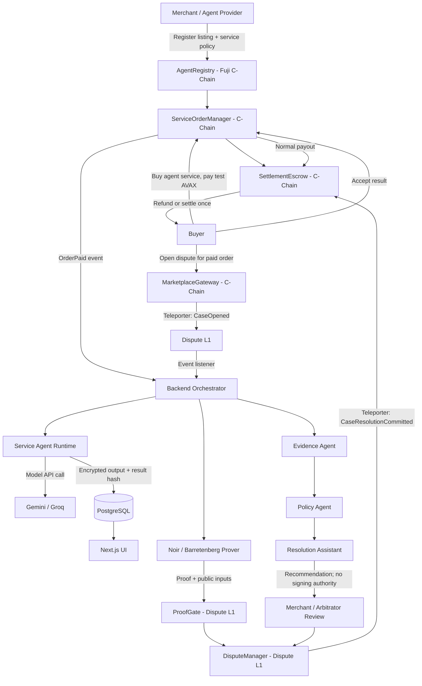

# KẾ HOẠCH TRIỂN KHAI V2 — DISPUTE PROTOCOL + SERVICE AGENT MARKETPLACE MVP

> **Dành cho:** Team 3 người · Hackathon 5 ngày · Avalanche Fuji C-Chain + Custom Dispute L1  
> **Phạm vi cập nhật:** Ngày 2 → Ngày 5. Giữ nguyên các thử nghiệm kỹ thuật quan trọng của Ngày 1.  
> **Mục tiêu sản phẩm:** Giữ **Dispute Protocol** là phần kỹ thuật cốt lõi, bổ sung **1 AI Service Agent có thể mua và chạy thực tế**, rồi dùng chính Dispute Protocol để giải quyết khiếu nại đối với dịch vụ đó.  
> **Nguyên tắc:** Không thêm tính năng mới vào Ngày 4–5. Không hy sinh luồng ICM + ZK + Escrow chỉ để tăng số lượng agent.

---

## 0. Quyết định phạm vi trước khi bắt đầu Ngày 2

### Những gì GIỮ từ kế hoạch cũ

- Fuji C-Chain quản lý thanh toán/escrow và cam kết chính sách tại thời điểm tạo giao dịch.
- Custom Dispute L1 quản lý tranh chấp, kiểm tra ZK proof, quyền Merchant/Arbitrator.
- Teleporter/ICM gửi **CaseOpened** từ C-Chain sang L1, và **CaseResolutionCommitted** từ L1 về C-Chain.
- Ba AI agent hỗ trợ xử lý tranh chấp: **Evidence Agent → Policy Agent → Resolution Assistant**.
- Noir + Barretenberg để chứng minh điều kiện hợp đồng riêng tư, **không** dùng zkML trong MVP.
- Tài liệu/bằng chứng giữ ở backend, mã hóa AES-256-GCM; AI không có quyền giải ngân.

### Những gì THÊM

- `AgentRegistry`: đăng ký tối thiểu một Service Agent và metadata/giá/chủ sở hữu. MVP dùng **danh sách agent được duyệt (curated)**; chưa mở cho bất kỳ ai tự chạy endpoint tùy ý.
- `ServiceOrderManager` (hoặc module đặt hàng tích hợp Gateway): người mua gọi `purchaseService(agentId, policyCommitment)` và trả AVAX testnet.
- Mở rộng `SettlementEscrow` để **khóa tiền thanh toán theo từng service order**, thay vì chỉ có khoản cọc bảo hành của Merchant.
- `Service Agent Runtime`: backend kiểm tra order đã thanh toán, gọi AI API, lưu output và cập nhật trạng thái bàn giao.
- Giao diện marketplace tối giản: **Browse Agent → Details → Buy → Execute → View Result → Accept / Dispute**.
- Cho `MarketplaceGateway.openCase(orderId)` xử lý **service order**, tái sử dụng Dispute Protocol hiện có.

### Phạm vi MVP bắt buộc (P0)

| Thành phần | Số lượng / yêu cầu tối thiểu |
|---|---|
| Service Agent bán được | **1** — gợi ý: **Document Summary Agent**; nhận văn bản/tài liệu giả lập, tạo bản tóm tắt có cấu trúc |
| Dispute Agents nội bộ | **3** (Evidence, Policy, Resolution) |
| AI model nền tảng | Có thể **1 model API** dùng cho nhiều agent khác prompt/tool; không nhất thiết 4 model |
| Marketplace | 1 listing với `agentId`, seller, giá; Buyer khác ví Seller; mua thật bằng **AVAX testnet** |
| Happy path 1 | Mua → chạy agent → xem kết quả → chấp nhận → tiền escrow trả Seller |
| Happy path 2 | Mua → chạy agent → mở tranh chấp → AI + ZK + Reviewer → hoàn tiền phù hợp |
| Cross-chain | Teleporter **hai chiều** trên testnet thật, có tx hash/message ID |
| ZK | Proof hợp lệ và proof không hợp lệ; verifier thật trên Dispute L1 nếu vượt được kiểm thử khả thi |

### Không thuộc P0

- 100–1.000 agents; Service Agent thứ hai trở lên; tự đăng bán agent tự do; license NFT; subscription; rating/reputation; zkML; token riêng; tích hợp mainnet.
- **Service Agent thứ 2 chỉ là P1**, làm khi P0 hoàn thành và đã tích hợp vào cuối Ngày 3. Không thêm agent mới trong Ngày 4.

> **Cách gọi sản phẩm khi pitch:** “Trust-enabled AI Service Marketplace MVP powered by a private dispute protocol”. Một listing và seller được duyệt là **marketplace MVP dạng curated**, chưa phải marketplace mở cho bên thứ ba.

---

## 1. Kiến trúc sản phẩm và luồng giao dịch thống nhất



### Hai loại tiền phải tách rõ

1. **Service order:** Buyer trả phí dịch vụ → escrow khóa **theo orderId**. Nếu Buyer chấp nhận / hết thời hạn khiếu nại theo quy tắc được định nghĩa rõ, trả cho Seller; nếu tranh chấp được duyệt, hoàn tiền cho Buyer theo số tiền được cho phép.
2. **Warranty order cũ:** Merchant ký quỹ bảo hành → escrow giữ quỹ riêng; chỉ trả bồi thường cho Buyer theo vụ việc đã được xác minh.

**Không gộp tiền khách hàng với quỹ ký quỹ của Merchant thành một số dư vô danh.** Có thể dùng chung một contract nhưng phải có accounting riêng cho từng loại và từng order.

### Lưu ý về ZK và bảo mật rất quan trọng

- `policyCommitment` được tạo và ghi **lúc mua dịch vụ**, có xác nhận của Seller và liên kết với `orderId` + `policyVersionHash`, không tự tạo lúc mở khiếu nại.
- Backend dùng **chính sách/hợp đồng đã xác nhận** làm nguồn dữ liệu tin cậy cho witness; **không** lấy giá trị hợp đồng do AI tự suy đoán rồi coi là nguồn sự thật.
- Với giải ngân AVAX công khai, **`payoutAmount`/`refundAmount` thực tế phải được ràng buộc vào proof và quyết định on-chain**. Không được chứng minh `proposedPayout` bí mật là hợp lệ rồi thực hiện chuyển một số tiền khác.
- `maxRefund` và điều khoản riêng tư có thể ẩn trong witness; **số AVAX chuyển on-chain không thể mặc nhiên coi là bí mật**.
- ZK chỉ xác minh điều kiện có tính xác định (thời hạn, giới hạn tiền, commitment); **không chứng minh chất lượng câu trả lời AI**. Merchant/Arbitrator đánh giá bằng chứng và phê duyệt cuối cùng.

### Bộ interface tối thiểu cần chốt ngay đầu Ngày 2

```text
AgentListing {
  agentId, seller, priceWei, metadataURI, active
}
ServiceOrder {
  orderId, agentId, buyer, seller, priceWei,
  policyCommitment, policyVersionHash,
  purchaseTimestamp, status
}
CaseOpened {
  caseId, orderId, policyCommitment,
  claimTimestamp, policyVersionHash, sourceChainId/nonce
}
CaseResolutionCommitted {
  caseId, orderId, outcomeCode,
  payoutAmount, reviewerApprovalRef, proofRef, nonce
}
```

**Quy tắc:** contract nhận kết quả phải đối chiếu `orderId`, `caseId`, số tiền còn khóa, message sender/chain đã allowlist, trạng thái tranh chấp và nonce trước khi giải ngân. `payoutAmount` là số tiền rõ trên settlement chain và phải khớp dữ liệu công khai đã xác minh / quyết định được ủy quyền.

---

## 2. Phân công cố định 3 người

| Người | Trách nhiệm chính | Không nên ôm thêm |
|---|---|---|
| **Người 1 — Blockchain / Avalanche** | `AgentRegistry`, `ServiceOrderManager`, `SettlementEscrow`, Gateway, L1 Dispute contracts, Teleporter, deploy, test on-chain | Giao diện Next.js, viết prompt AI |
| **Người 2 — ZK & Backend** | Noir circuit, verifier integration, API, PostgreSQL, mã hóa, prover service, event listener, executor/service order authorization | Chỉnh sửa thông điệp/role của contract mà không chốt với Người 1 |
| **Người 3 — AI & Frontend** | Service Agent prompt/runtime adapter, 3 Dispute Agents, UI marketplace + buyer + reviewer, tích hợp ví | Quản trị private key deploy/DB production |

### Quy tắc phối hợp

- Một GitHub repo, branch theo tính năng; PR merge thường xuyên, không đợi tới Ngày 3 mới tích hợp.
- Chốt ABI, event names, REST endpoints, mẫu JSON đầu vào/đầu ra **trước 10:00 Ngày 2**.
- Mỗi người tạo ví test riêng; tài khoản Buyer / Seller / Arbitrator khác địa chỉ; **không chia sẻ seed phrase/private key**.
- Không commit `.env`, API key, DB credentials, witness bí mật; commit `.env.example` và cấu hình public (RPC URL, chain ID, contract address).
- Mỗi ngày có bản build tích hợp trên `staging`; backend không cần mở truy cập trực tiếp PostgreSQL cho frontend.

---

## NGÀY 2 — CORE LOGIC + SERVICE MARKETPLACE SKELETON

> **Mục tiêu ngày:** Marketplace đã có listing/order trả phí trên local; Service Agent trả kết quả thật; Dispute Protocol + ZK chạy unit test độc lập. **Chưa cần UI end-to-end trên testnet.**

### 08:30–10:00 — Cả nhóm: Chốt contract/API/schema

- [ ] Định nghĩa service agent P0: **Document Summary Agent**; input ngắn, output JSON có cấu trúc, giá testnet; demo bằng tài liệu giả.
- [ ] Chốt chính sách: khoảng thời gian mở khiếu nại; mức hoàn tiền tối đa; trường hợp `ACCEPTED` và timeout.
- [ ] Chốt `agentId`, `orderId`, `caseId`, schema event, các enum status, JSON trả về; mỗi người có 1 fixture chung.
- [ ] Quyết định cơ chế ký/đồng ý `policyCommitment` lúc checkout; giữ đúng phiên bản policy và order.

### 👤 Người 1 — Blockchain / Solidity

**Sáng (sau 10:00):**

- [ ] Giữ `MerchantPolicyRegistry`/luồng warranty cũ, nhưng tách policy theo `orderId` để xử lý cả service order.
- [ ] Thêm `AgentRegistry.sol`: `registerAgent`, `setAgentActive`, `getAgent` (chỉ địa chỉ được duyệt có quyền register trong MVP).
- [ ] Thêm `ServiceOrderManager.sol`: `purchaseService` payable, kiểm tra listing active/price, tạo `orderId`, emit `ServicePurchased` và ghi commitment **ngay lúc giao dịch**.
- [ ] Mở rộng `SettlementEscrow.sol`: khóa tiền theo order, release Seller / refund Buyer **một lần duy nhất**, kiểm tra đủ số dư.

**Chiều:**

- [ ] Giữ/hoàn thiện `MarketplaceGateway`, `DisputeInbox`, `DisputeManager`, `ProofGate`, `DisputeResultSender/Receiver` theo README hiện tại.
- [ ] `openCase(orderId)` chỉ cho Buyer hợp lệ, order chưa quyết toán và đang trong cửa sổ khiếu nại.
- [ ] Test local: thanh toán sai giá, mua agent inactive, mở khiếu nại sai Buyer, refund hai lần, accept sau dispute, thông điệp trùng lặp.
- [ ] Test stub Teleporter và role trên local; không đợi công việc AI mới viết unit test.

**Bàn giao:** ABI bản đầu, events/schemas, tests Foundry/Hardhat pass trên local, địa chỉ contract local và danh sách lỗi tồn đọng.

### 👤 Người 2 — ZK / Backend

**Sáng:**

- [ ] Hoàn thiện Noir policy circuit của README nhưng dùng `orderId` và chính sách service order tương ứng.
- [ ] Private witness: thời điểm mua, thời hạn khiếu nại, giới hạn refund (`maxRefund`), nonce và các trường đã commit.
- [ ] Public input: `caseId`/`orderId` (hoặc hash có domain binding), `policyCommitment`, `claimTimestamp` on-chain, `policyVersionHash`, **`refundAmount` sẽ giải ngân**, nullifier/one-time marker.
- [ ] Constraints: commitment khớp; thời hạn khiếu nại hợp lệ; `refundAmount <= maxRefund`; proof gắn đúng case/version/domain; ngăn phát lại.
- [ ] Tạo test proof tốt / quá hạn / vượt giới hạn refund. Kiểm tra phiên bản Noir/Barretenberg, kích thước verifier và precompile thực tế từ Ngày 1.

**Chiều:**

- [ ] PostgreSQL tối thiểu: `agent_listings_cache`, `service_orders`, `cases`, `evidence`, `agent_outputs`; lưu dữ liệu nhạy cảm bằng AES-256-GCM, có IV/nonce và auth tag theo bản ghi.
- [ ] Backend: `GET /api/agents`, `GET /api/orders/:id`, `POST /api/orders/:id/execute`, `POST /api/cases/upload`.
- [ ] Service executor chỉ chạy khi order **đã thanh toán và được xác nhận trên chain**, có kiểm tra buyer/định danh, idempotency và rate limit; API key giữ ở server.
- [ ] Prover service đọc policy đã cam kết, tạo witness từ dữ liệu tin cậy; trả proof/public inputs (không log private witness).
- [ ] Tạo mock provider và mock contract event để Người 3 có thể tích hợp ngay.

**Bàn giao:** `nargo`/Barretenberg proof test pass, backend API local chạy, DB migrations, JSON examples, unit tests.

### 👤 Người 3 — Service Agent + Dispute AI + UI

**Sáng:**

- [ ] Làm **1 Service Agent thật**: Document Summary Agent; gọi API Gemini/Groq qua backend adapter; input giả lập, output JSON `{summary, keyPoints, caveats}`.
- [ ] Giữ 3 Dispute Agents: Evidence (đọc bằng chứng) → Policy (diễn giải chính sách đã xác nhận) → Resolution (đề xuất mức refund có lý do).
- [ ] Định dạng JSON schema rõ ràng; xử lý timeout/rate-limit/invalid JSON; không để AI sinh private witness tùy ý.

**Chiều:**

- [ ] Dựng Next.js: Agent Catalog, Agent Detail, Buy/Execute, Result, Open Dispute, Case Timeline, Reviewer.
- [ ] Cắm dữ liệu mock tương ứng API đã chốt; dùng wallet giả/mock transaction khi contract thật chưa sẵn.
- [ ] Thiết kế rõ status `PAID → RUNNING → DELIVERED → ACCEPTED` hoặc `DISPUTED`.
- [ ] Cấu hình frontend chỉ có public env vars; **không** đưa AI API key vào Next.js client.

**Bàn giao:** 1 Service Agent gọi model thành công, pipeline 3 Dispute Agents trả JSON có cấu trúc, UI đầy đủ màn hình cơ bản với mock data.

### ✅ Gate cuối Ngày 2 (18:00)

- [ ] `registerAgent → purchaseService → escrowLocked` pass trong unit tests.
- [ ] Service Agent chạy được bằng API call thật với input giả lập.
- [ ] Noir circuit có một proof thành công và một test sai thất bại.
- [ ] Các schema/API/ABI không còn mâu thuẫn; frontend mock có thể đi hết các màn hình.
- [ ] **Nếu các contract cũ/ICM/ZK vẫn chưa có nền tảng chạy được, hạ Service Agent xuống P1 ngay; ưu tiên hoàn thành Dispute Protocol.**

---

## NGÀY 3 — INTEGRATION: MARKETPLACE → DISPUTE → SETTLEMENT

> **Mục tiêu ngày:** Có ít nhất **1 service purchase thật** và **1 dispute thật** kết nối cả hai chain, chạy được từ UI mà không thao tác terminal thủ công.

### Sáng 08:30–12:00 — Deploy và tích hợp

**👤 Người 1:**

- [ ] Deploy/update `AgentRegistry`, `ServiceOrderManager`, `SettlementEscrow`, `MarketplaceGateway`, `DisputeResultReceiver` lên Fuji C-Chain.
- [ ] Deploy `DisputeInbox`, `DisputeManager`, `ProofGate`, `DisputeResultSender`, Solidity verifier lên Custom Dispute L1.
- [ ] Xác thực Teleporter/relayer hai chiều, allowlist chain+sender, chain ID và blockchain ID, tránh nhầm nhau.
- [ ] Chia sẻ file ABI, manifest `deployments/fuji.json`, `deployments/dispute-l1.json` (chỉ địa chỉ public, không có key).

**👤 Người 2:**

- [ ] Kết nối DB/backend staging, seed một agent và chính sách service giả lập (commitment thật từ checkout).
- [ ] Watch `ServicePurchased` trên Fuji → kích hoạt service executor theo yêu cầu hợp lệ; không chạy lặp khi event được xử lý lại.
- [ ] Watch `CaseOpened` trên Dispute L1 → chạy Evidence/Policy/Resolution → prover → nộp proof bằng relayer/submitter có quyền tối thiểu.
- [ ] Kết nối trạng thái order/case, thống nhất xác nhận giao dịch và retry; tránh báo thành công trước khi final state cập nhật.

**👤 Người 3:**

- [ ] Kết nối ví buyer/seller/reviewer bằng Wagmi/Viem, hiển thị đúng mạng Fuji / Dispute L1.
- [ ] Browse agent → Buy → Execute → View result → Accept / Dispute; tích hợp API + smart contract thật.
- [ ] Reviewer page có nút approve/reject qua ví đúng role, hiển thị proof status và link explorer.

**Checkpoint 12:00:** Nếu chưa mua được một service order trên testnet qua UI, cả nhóm dừng mở rộng, ưu tiên sửa đường `Buy → Run → Result` và kiện tranh chấp.

### Chiều 13:30–18:00 — End-to-end scenarios

**Kịch bản A — Không có tranh chấp (testnet thật):**

1. Seller đăng **Document Summary Agent**, giá tính bằng AVAX testnet.
2. Buyer kết nối ví khác Seller, mua dịch vụ; C-Chain khóa phí vào escrow và ghi `policyCommitment` ở thời điểm mua.
3. Backend phát hiện order đã thanh toán, gọi model API; lưu kết quả riêng tư off-chain và công bố result hash/metadata tối thiểu.
4. Buyer xem kết quả và chọn **Accept**; Escrow release cho Seller **đúng một lần**.

**Kịch bản B — Có tranh chấp (testnet thật):**

1. Buyer mua order mới, agent tạo kết quả; Buyer chọn **Open Dispute** vì không đáp ứng thỏa thuận được mô tả trong bằng chứng giả lập.
2. `MarketplaceGateway` gửi `CaseOpened` qua Teleporter sang Dispute L1, gồm commitment lúc mua và timestamp lấy từ C-Chain.
3. Backend nhận event → ba Dispute Agents phân tích → tạo khuyến nghị + proof từ policy witness đã xác thực.
4. `ProofGate` xác minh proof gắn với case, commitment, policy version và refundAmount.
5. Seller/Arbitrator review và **Approve refund** trên L1.
6. L1 gửi `CaseResolutionCommitted` qua Teleporter về C-Chain; Escrow refund Buyer; state không thể chi trả lần hai.
7. UI hiển thị outcome, state cập nhật và explorer links trên cả hai chain.

**Bàn giao Ngày 3:**

- [ ] 2 đường A/B chạy thật ít nhất một lần.
- [ ] Có tx hash, message ID, proof verification receipt, thời gian và số AVAX testnet cho bản demo.
- [ ] Có dữ liệu seed/replay phục vụ demo, nhưng **không được giả vờ mock là giao dịch on-chain thật**.
- [ ] Không còn thao tác console thủ công ở happy path.
- [ ] **Chỉ cân nhắc thêm Service Agent #2 nếu tất cả checklist trên đã xong trước 18:00.** Trong thực tế nên ưu tiên ổn định thay vì bổ sung agent.

---

## NGÀY 4 — SECURITY, FAILURE CASES & UX (KHÔNG THÊM TÍNH NĂNG MỚI)

> **Mục tiêu ngày:** Cả luồng mua dịch vụ và tranh chấp đều hoạt động ổn định; xử lý các thất bại mà người chấm có thể hỏi.

### 👤 Người 1 — Contract & Cross-chain Hardening

**Sáng:**

- [ ] Unauthorized buyer mở dispute / người không phải Seller hoặc Arbitrator bấm approve → revert.
- [ ] Proof sai case, sai `policyCommitment`, sai public `refundAmount`, sai timestamp → revert.
- [ ] Nullifier / `caseId` / Teleporter nonce bị phát lại → không phát sinh double settlement.
- [ ] Buyer không thể `accept` rồi lại `dispute` cùng order; số dư escrow luôn khớp.

**Chiều:**

- [ ] Kiểm tra phản hồi timeout/reject của Merchant và khả năng Arbitrator tiếp quản đúng role.
- [ ] Relayer trễ/tạm dừng: chỉ hiển thị **PENDING**, không gọi payout lại hoặc tự giải ngân bypass proof.
- [ ] Nếu cần quy trình cứu hộ thủ công: chỉ retry/resubmit thông điệp hợp lệ qua quyền hạn rõ ràng; không xây một lệnh admin tùy ý rút tiền.
- [ ] Thu thập gas usage, địa chỉ contract, tx hashes, message receipt.

### 👤 Người 2 — ZK, Privacy & Backend Reliability

**Sáng:**

- [ ] Case hợp lệ theo chính sách → proof verified, reviewer có thể xét hoàn tiền.
- [ ] Case quá cửa sổ khiếu nại hoặc vượt max refund → witness không thỏa constraint / proof bị từ chối.
- [ ] Kiểm tra `policyCommitment` tạo **lúc mua** và immutable sau khi xảy ra tranh chấp.
- [ ] Test local với timestamp giả lập; **trên Fuji không sử dụng hardcode ngày 15/03/2026 hoặc 15/07/2026 làm claimTimestamp thật**, vì hiện tại đã qua những ngày đó.

**Chiều:**

- [ ] Bằng chứng, hợp đồng, AI output nhạy cảm được mã hóa; thử giải mã bằng sai key phải thất bại.
- [ ] Kiểm tra auth, giới hạn file upload, không log API key/witness, giới hạn số lần gọi AI và chống execute trùng order.
- [ ] Retry event listener idempotent; tái khởi động backend không sinh một order/proof/payout thứ hai.
- [ ] Thống kê proof time, verifier gas, AI latency, message delivery time từ test thật.

### 👤 Người 3 — Marketplace UX & Reviewer UX

**Sáng:**

- [ ] Cải thiện Browse/Buy/Execute/Dispute/Result và trạng thái ví, xử lý lỗi thiếu gas/sai chain/hết API quota.
- [ ] Link explorer cho service purchase, `CaseOpened`, `ProofVerified`, `CaseResolutionCommitted`, settlement.
- [ ] Nêu rõ `AI recommendation` không phải phán quyết; chỉ `Merchant / Arbitrator` có thể approve/reject.

**Chiều:**

- [ ] Chuyển đổi Buyer / Seller / Arbitrator bằng ví test khác nhau, không có nút giả có quyền vượt role.
- [ ] Toast/timeline `Awaiting cross-chain relay`, `Proof verified`, `Awaiting reviewer`, `Refunded/Released`.
- [ ] Quay thử full demo; giao diện dùng dữ liệu giả lập sạch, không làm lộ private files / env variables.

### ✅ Gate cuối Ngày 4

- [ ] Service Agent thực thi thật; 3 Dispute Agents thực thi thật.
- [ ] Test A: service accepted / tiền đến Seller.
- [ ] Test B: dispute approved / tiền hoàn Buyer.
- [ ] Test C: quá hạn hoặc refund vượt giới hạn / proof không hợp lệ.
- [ ] Test D: double payout, replay, unauthorized roles đều bị từ chối.
- [ ] Cả hai chain có tx hash kiểm tra được; nếu có giới hạn demo thì ghi rõ, không nói quá năng lực sản phẩm.

---

## NGÀY 5 — CODE FREEZE, DEMO, PITCH & SUBMISSION

> **Mục tiêu ngày:** Không thêm logic hoặc service agent; đóng gói bản demo đáng tin cậy và giải thích rõ *vì sao Avalanche + ZK + AI là cần thiết*.

### Sáng 08:30–12:00 — Freeze và quay video 3–5 phút

**Kịch bản đề xuất (4 phút 30 giây):**

| Thời lượng | Nội dung |
|---|---|
| 0:00–0:35 | Nỗi đau: mua dịch vụ AI khó có cơ chế xử lý khi không đáp ứng cam kết; hợp đồng có điều khoản riêng tư |
| 0:35–1:00 | Xem marketplace: Document Summary Agent, giá và chính sách dịch vụ |
| 1:00–1:40 | Buyer mua dịch vụ bằng AVAX testnet; `policyCommitment` ghi ngay lúc mua; agent chạy API thật và trả kết quả |
| 1:40–2:35 | Buyer khiếu nại; Teleporter đưa case sang Dispute L1; 3 AI agents xử lý; ZK proof xác minh |
| 2:35–3:25 | Reviewer phê duyệt; Teleporter về C-Chain; escrow hoàn tiền; show 2 explorer và tx hash |
| 3:25–4:00 | Show case ZK từ chối vì sai thời hạn/refund và test chống double payout |
| 4:00–4:30 | Roadmap: từ marketplace curated 1 agent → nhiều service agents → bên thứ ba đăng bán |

- [ ] Quay thêm bản dự phòng; ghi lại tx hashes và proof receipt.
- [ ] Có thể trình bày đường **Accept → Seller payout** bằng video/phần chèn nhanh nếu thời lượng còn.
- [ ] Không đưa tên, tài liệu hoặc private key thật vào recording.

### Chiều 13:30–17:00 — Slide, README, submit

**Slide pitch 10–12 trang:**

1. Problem: Trust gap in paid AI services.
2. Product: AI Service Marketplace + Dispute Protocol.
3. User flow: Buy → Execute → Accept/Dispute → Settlement.
4. Architecture: C-Chain + Dispute L1 + Teleporter + off-chain AI/ZK prover.
5. Marketplace MVP: listing, purchase, API-backed execution.
6. Why Custom L1 & ICM? Chuyên biệt hóa workflow tranh chấp, chuyển thông điệp đã xác thực.
7. Why ZK? Chứng minh các giới hạn hợp đồng đã cam kết mà không công bố toàn bộ điều khoản.
8. Three Dispute Agents + human-in-the-loop decision.
9. Live demo: explorer proof, order, refund.
10. Security tests: wrong commitment, replay, role controls, delayed relay.
11. Metrics: proof generation time, verifier gas, ICM delivery, AI latency.
12. Roadmap: open marketplace, many agent providers, audits, scalability.

**README/GitHub cần có:**

- [ ] Cách chạy local; scripts test, seed, environment examples.
- [ ] RPC URLs, EVM chain ID và Avalanche blockchain ID, tên explorer.
- [ ] Contract addresses/ABI; mẫu `agentId`, `orderId`, `caseId`.
- [ ] Tx hashes và ICM message IDs cho demo testnet.
- [ ] Sơ đồ data privacy, threat model rút gọn, hạn chế của demo.
- [ ] Có thể mở rộng Service Agents nhưng **P0 hiện tại chưa hỗ trợ listing permissionless**.
- [ ] Submit dự án trước deadline thực tế ít nhất 1–2 giờ.

---

## 3. Đường găng, điểm kiểm soát và phương án cắt phạm vi

| Mốc | Phải chạy được | Nếu chưa chạy được |
|---|---|---|
| **Cuối Ngày 1** | Custom L1 + Teleporter hai chiều + verifier deploy thử được | Ưu tiên khôi phục core infrastructure; **không mở rộng marketplace** |
| **Ngày 2 — 18:00** | `register → purchase → escrow`, 1 Service Agent API, Noir proof độc lập | Loại Service Agent khỏi P0, quay về Dispute Protocol gốc |
| **Ngày 3 — 12:00** | Mua và chạy Service Agent qua UI staging | Dừng làm UI phụ, tập trung wiring core và ICM |
| **Ngày 3 — 18:00** | Service settlement và service dispute giải ngân thật qua ICM | Không thêm agent thứ hai; nếu không ổn định, pitch Dispute Protocol là sản phẩm chính |
| **Ngày 4 — 18:00** | Các case thành công/thất bại, auth và replay tests | Chỉ fix blocker, không phát triển features |
| **Ngày 5** | Video dự phòng + slide + chain evidence | Bỏ tính năng demo không chạy thật; không giả claim |

### Ưu tiên khi thiếu thời gian (giảm dần)

1. **Giữ:** Dispute L1 + Teleporter hai chiều + settlement escrow + policy commitment lúc tạo order.
2. **Giữ:** ZK verifier/proof thật gắn với `caseId`, `orderId`, commitment và khoản refund.
3. **Giữ:** 1 Service Agent có giao dịch trả phí và chạy API thật.
4. **Có thể giản lược:** Giao diện marketplace fancy, thêm nhiều form, nhiều vai trò UI phức tạp.
5. **Bỏ ngay:** Agent thứ hai, auto-discovery, agent NFT, subscription, zkML, ranking, rating, production validator setup.

> **Đánh giá khả thi:** Đây là kế hoạch *tham vọng cao* cho 3 người/5 ngày, nhất là khi L1, relayer và Noir verifier đều làm mới. Việc thêm một Service Agent là hợp lý **chỉ khi Ngày 1 đã vượt được các thử nghiệm Go/No-Go**, và Ngày 2 không bị kẹt vì hạ tầng.

---

## 4. Gợi ý tổ chức repository

```text
project/
├── apps/
│   ├── web/                     # Next.js marketplace + dispute UI
│   └── api/                     # REST API, auth, event listener, encrypted storage
├── services/
│   ├── service-agents/          # 1 API-backed Document Summary Agent (P0)
│   ├── dispute-agents/          # Evidence, Policy, Resolution
│   └── prover/                  # Noir / Barretenberg witness + proof service
├── contracts/
│   ├── c-chain/                 # AgentRegistry, ServiceOrderManager,
│   │                            # MerchantPolicyRegistry, SettlementEscrow,
│   │                            # MarketplaceGateway, DisputeResultReceiver
│   ├── dispute-l1/              # DisputeInbox, DisputeManager,
│   │                            # ProofGate, DisputeResultSender
│   └── test/
├── circuits/
│   └── policy-eligibility/
├── deployments/
│   ├── fuji.json                # Public addresses only
│   └── dispute-l1.json          # Public addresses only
├── infra/
│   ├── avalanche-l1/
│   └── icm/
├── docs/
│   ├── api-contract.md
│   ├── message-schema.md
│   ├── threat-model.md
│   └── demo-script.md
├── .env.example
└── README.md
```

### Chia sẻ tài khoản và môi trường

- Mỗi người có wallet test riêng (Buyer, Seller, Arbitrator), không ai gửi private key/seed phrase qua chat/GitHub.
- Dev dùng API key riêng nếu có thể; staging dùng key đặt trong secrets của server, quyền truy cập tối thiểu.
- DB local tùy người; PostgreSQL staging có account ứng dụng riêng, không dùng chung tài khoản superuser.
- Dùng một contract deployment manifest và version ABI cho cả nhóm, cập nhật qua PR.
- Testnet dùng AVAX testnet; **không yêu cầu người dùng nạp tiền thật** cho demo.

---

## 5. Hai lưu ý hạ tầng phải lên lịch trước

1. **Hosted relayer của Avalanche Builder Hub có thể tự dừng sau 3 ngày.** Nếu tạo Ngày 1, nó có thể dừng trước buổi demo Ngày 4/5. Cần lên lịch kiểm tra, khởi tạo lại theo công cụ nếu được hoặc chuẩn bị self-hosted relayer/backup rõ ràng; không giả định relay luôn chạy.
2. **TeleporterMessenger/Registry và relayer phải được cấu hình đúng trên custom L1**, trong khi các contract tương ứng có thể đã được triển khai trên Fuji C-Chain. Lưu các ID và địa chỉ chuẩn từ tài liệu/deploy thực tế; không lấy EVM chain ID thay cho Avalanche blockchain ID.

**Tài liệu tham khảo:**

- [Avalanche ICM Overview](https://build.avax.network/academy/avalanche-l1/interchain-messaging)
- [ICM Infrastructure Setup](https://build.avax.network/academy/avalanche-l1/interchain-messaging/04-icm-setup/01-overview)
- [Relayer Setup](https://build.avax.network/academy/avalanche-l1/interchain-messaging/04-icm-setup/04-relayer-setup)
- [Noir Documentation](https://noir-lang.org/docs/)

---

## 6. Tiêu chí xác nhận sản phẩm đã là một marketplace MVP

- [ ] Có listing/service mà Buyer có thể khám phá và chọn.
- [ ] Có Seller sở hữu listing và Buyer ở ví khác thực hiện mua dịch vụ qua smart contract.
- [ ] Có giá thực, thanh toán testnet, order ID và escrow theo order.
- [ ] Có Service Agent chạy API thật, trả output và trạng thái cho Buyer.
- [ ] Có luồng chấp nhận kết quả và giải ngân Seller.
- [ ] Có luồng khiếu nại kết quả dịch vụ, cùng Dispute Protocol gốc xác minh ZK và xử lý hoàn tiền.
- [ ] Có thể chứng minh toàn bộ bằng giao dịch và message hai chain, không chỉ mock UI.
- [ ] Có hướng mở rộng `AgentRegistry` cho nhiều seller/agent trong P2 mà không phải viết lại Dispute Protocol.

**Kết luận:** Không thêm Service Agent ở Ngày 4. Hãy chuẩn bị schema, escrow và một listing ngay Ngày 2, tích hợp xong trước cuối Ngày 3, sau đó dành toàn bộ Ngày 4–5 cho độ tin cậy và demo. Nếu không vượt qua các điểm Go/No-Go, chọn demo Dispute Protocol hoàn chỉnh thay vì một Marketplace nửa vời.
