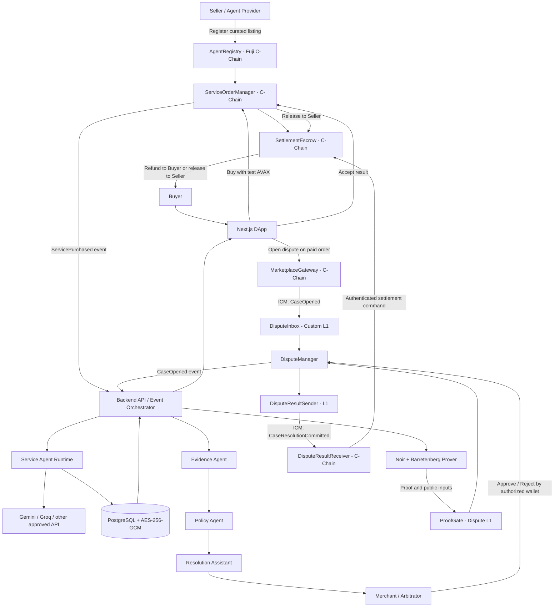

# Avalanche AI Agent Marketplace & Private Dispute Protocol

**Mốc ngày 1:** đã chốt công việc; xem [báo cáo kiểm chứng và các mục tồn đọng](project/docs/DAY1-LATEST-STATUS.md). Proof hello-world đã verify trên Dispute L1. Teleporter Fuji → L1 đã xác thực; chiều về và kiểm thử AI live còn tồn đọng. Hướng dẫn chạy: [README-DAY1.md](project/README-DAY1.md).

**Mốc ngày 2:** demo local đã qua kiểm thử marketplace, escrow, dispute, proof policy WASM, backend PostgreSQL và build frontend. Xem [hướng dẫn demo Day 2](project/README-DAY2.md). AI live chờ OpenRouter key, Teleporter chiều về và `bb` native vẫn là việc tồn đọng.

> **Trạng thái:** Tài liệu thiết kế và kế hoạch triển khai (**planned MVP**, không phải tuyên bố đã hoàn thành).  
> **Nhóm:** 3 người · Hackathon 5 ngày · Ngôn ngữ tài liệu: Tiếng Việt.  
> **Mạng thử nghiệm:** Avalanche **Fuji C-Chain** + một **Avalanche EVM L1 tùy chỉnh (Dispute L1)**.  
> **Định hướng:** Bắt đầu bằng **marketplace dạng curated với 1 Service Agent thực sự có thể mua và sử dụng**, lấy **Private Dispute Protocol** và 3 Dispute Agents làm điểm khác biệt. Mở rộng thành marketplace đa agent/đa nhà cung cấp sau hackathon.  
> **Kế hoạch công việc chi tiết:** [`AVALANCHE_DISPUTE_TO_MARKETPLACE_PLAN_DAY2_DAY5.md`](./AVALANCHE_DISPUTE_TO_MARKETPLACE_PLAN_DAY2_DAY5.md).

## Mục lục

1. [Tổng quan và quyết định phạm vi](#1-tổng-quan-và-quyết-định-phạm-vi)
2. [Sản phẩm, vai trò và chức năng](#2-sản-phẩm-vai-trò-và-chức-năng)
3. [Kiến trúc hệ thống](#3-kiến-trúc-hệ-thống)
4. [Luồng nghiệp vụ và dòng tiền](#4-luồng-nghiệp-vụ-và-dòng-tiền)
5. [Avalanche L1, Teleporter và ICM](#5-avalanche-l1-teleporter-và-icm)
6. [Smart contracts và state machine](#6-smart-contracts-và-state-machine)
7. [Service Agent và 3 Dispute Agents](#7-service-agent-và-3-dispute-agents)
8. [Dữ liệu, bảo mật và quyền riêng tư](#8-dữ-liệu-bảo-mật-và-quyền-riêng-tư)
9. [ZK circuit: chứng minh điều khoản dịch vụ](#9-zk-circuit-chứng-minh-điều-khoản-dịch-vụ)
10. [Backend, API và tích hợp](#10-backend-api-và-tích-hợp)
11. [Kế hoạch hackathon Ngày 1–5](#11-kế-hoạch-hackathon-ngày-15)
12. [Phân công 3 người và quy trình phối hợp](#12-phân-công-3-người-và-quy-trình-phối-hợp)
13. [Cấu trúc repository](#13-cấu-trúc-repository)
14. [Kiểm thử và tiêu chí nghiệm thu](#14-kiểm-thử-và-tiêu-chí-nghiệm-thu)
15. [Kịch bản demo và pitch](#15-kịch-bản-demo-và-pitch)
16. [Ưu tiên P0/P1/P2 và phương án dự phòng](#16-ưu-tiên-p0p1p2-và-phương-án-dự-phòng)
17. [Hướng dẫn cấu hình và tài liệu tham khảo](#17-hướng-dẫn-cấu-hình-và-tài-liệu-tham-khảo)

---

## 1. Tổng quan và quyết định phạm vi

### 1.1. Vấn đề

Người mua một dịch vụ AI có thể nhận kết quả không đạt kỳ vọng nhưng thiếu cơ chế minh bạch để đối chiếu **điều khoản đã đồng ý khi thanh toán**, xử lý khiếu nại, hoàn tiền và kiểm toán quyết định. Đồng thời, nội dung tài liệu, chính sách thương mại và bằng chứng có thể nhạy cảm, không phù hợp đưa trực tiếp lên blockchain.

### 1.2. Giải pháp

Xây dựng một sản phẩm **thống nhất** gồm hai lớp:

- **AI Service Marketplace:** Người bán được duyệt đăng một Service Agent; người mua chọn, thanh toán bằng **AVAX testnet**, chạy AI qua backend và nhận kết quả. Tiền mua dịch vụ được khóa trong escrow theo `orderId` cho đến khi chấp nhận kết quả hoặc xử lý tranh chấp.
- **Private Dispute Protocol:** Nếu kết quả dịch vụ bị khiếu nại, 3 Dispute Agents hỗ trợ phân tích hồ sơ; **Noir/Barretenberg ZK proof** kiểm tra các điều kiện định lượng đã cam kết; **Merchant/Arbitrator** có quyền duyệt cuối cùng; **Teleporter/ICM** chuyển hồ sơ và quyết định giữa Fuji C-Chain và Dispute L1.

**Một luồng sản phẩm:** `Discover → Buy → Execute → Accept hoặc Dispute → Settle`. Không ghép một “chợ AI” và một “ứng dụng bảo hành” độc lập chỉ để trình diễn nhiều công nghệ.

### 1.3. Phạm vi thực tế của hackathon

| Hạng mục | MVP P0 (5 ngày) | Chưa thuộc P0 |
|---|---|---|
| Service Agents có thể mua | **1 Document Summary Agent**, gọi API thật | 100–1.000 agents |
| Dispute Agents nội bộ | **3:** Evidence, Policy, Resolution | Thay thế con người bằng AI judge |
| AI models nền tảng | Có thể **1 model/API** dùng cho nhiều vai trò | 4 model khác nhau là bắt buộc |
| Marketplace | **Curated:** 1 listing do Seller được duyệt quản lý | Listing tự do/permissionless, NFT license |
| Thanh toán | AVAX **testnet**, order-specific escrow, release/refund | Mainnet, token riêng, subscription |
| Avalanche | Fuji C-Chain + Custom Dispute L1; Teleporter hai chiều | Multi-L1 production |
| Privacy | AES-256-GCM ngoài chain; ZK cho chính sách riêng tư | zkML, quyền riêng tư toàn bộ giao dịch |
| Phán quyết | AI đề xuất; Merchant/Arbitrator có quyền duyệt | AI tự giải ngân |

> **Cách giới thiệu chính xác:** “A curated AI Service Marketplace MVP with privacy-preserving cross-chain dispute resolution on Avalanche.” Có marketplace tối thiểu **khi và chỉ khi** listing → mua → chạy agent → quyết toán hoạt động thật. Nếu phần đó chưa hoàn thành, sản phẩm thực tế vẫn chỉ là Dispute Protocol; không gọi đó là marketplace đầy đủ.

### 1.4. Điều kiện thành công

- **Luồng A:** Buyer mua Document Summary Agent → agent chạy API thật → Buyer **Accept** → Escrow trả tiền cho Seller đúng một lần.
- **Luồng B:** Buyer mua dịch vụ khác hoặc tạo order mới → nhận kết quả → **Dispute** → `CaseOpened` qua Teleporter → 3 Dispute Agents + ZK → Reviewer duyệt → `CaseResolutionCommitted` quay về C-Chain → Escrow hoàn tiền cho Buyer.
- **Luồng C:** Khiếu nại sai thời hạn hoặc yêu cầu refund quá giới hạn → **không thể được xác minh/giải ngân theo đường hợp lệ**.
- Có ABI, chain ID, blockchain ID, tx hashes, message IDs và proof receipt để giám khảo kiểm chứng. Không ghi tính năng chưa triển khai là đã chạy.

## 2. Sản phẩm, vai trò và chức năng

| Vai trò | Có thể làm gì? | Không được phép |
|---|---|---|
| **Seller / Agent Provider** | Quản lý listing đã được duyệt, công bố giá/chính sách; nhận phí sau khi hoàn thành; review dispute của order mình | Tự lấy tiền đã escrow, sửa chính sách một chiều sau checkout |
| **Buyer** | Xem listing, mua, yêu cầu AI chạy, xem output; chấp nhận hoặc mở tranh chấp trước thời hạn | Mở case cho order người khác, nhận refund hai lần |
| **Merchant / Reviewer** | Duyệt hoặc từ chối phương án giải quyết theo quyền đã cấp | Bỏ qua proof bắt buộc hoặc sửa số tiền refund đã được chứng minh |
| **Arbitrator** | Xử lý tranh chấp được chuyển cấp hoặc quá hạn phản hồi, theo quy tắc công bố | Tự tạo order giả, rút escrow vô điều kiện |
| **Backend operator** | Điều phối model API, lưu mã hóa, theo dõi event và nộp proof | Tự quyết định chuyển AVAX hoặc giả mạo chữ ký người dùng |

**MVP chỉ mở đăng listing cho địa chỉ được duyệt.** Seller và Buyer phải dùng **hai địa chỉ ví khác nhau** khi demo. Một ví có thể được phân quyền reviewer cho môi trường test, nhưng ví/role cần tách bạch về mặt kiểm thử.

### 2.1. Service Agent P0

**Document Summary Agent:** Nhận văn bản/tài liệu mẫu, tạo JSON như `{summary, keyPoints, caveats}`. Kết quả được lưu off-chain; trả cho Buyer đã mua dịch vụ, không công khai nội dung lên chain. Input và output có thể là dữ liệu giả lập để bảo vệ quyền riêng tư khi demo.

### 2.2. Dispute Agents P0

1. **Evidence Agent:** Tóm tắt yêu cầu, bằng chứng, output của Service Agent, tìm dữ kiện thiếu.
2. **Policy Agent:** Đọc chính sách đã được đối chiếu với bản cam kết của Seller và nêu điều khoản liên quan; hỗ trợ ánh xạ dữ liệu cho prover, **không tự xác lập private witness**.
3. **Resolution Assistant:** Đề xuất `refundAmount`/phương án xử lý và giải thích cho Reviewer; **không có private key giải ngân**.

**Agent khác model:** 4 vai trò agent có thể dùng cùng một LLM API và những prompt/tool/schema khác nhau. MVP cần **1 Service Agent + 3 Dispute Agents**, không đồng nghĩa cần bốn model AI riêng biệt.

## 3. Kiến trúc hệ thống



### 3.1. Trách nhiệm của mỗi lớp

| Lớp | Trạng thái và xử lý | Không đặt vào đây |
|---|---|---|
| **Fuji C-Chain** | `AgentRegistry`, giá/listing; service order, người mua/bán; `policyCommitment` tại checkout; AVAX escrow và kết quả settlement | PDF riêng tư, prompt chứa bí mật, API key |
| **Dispute L1** | Trạng thái case, ZK verification, quyết định reviewer, audit trail tối thiểu | File gốc, full policy plaintext, private witness |
| **Backend** | API xác thực, order execution, watcher, mã hóa PostgreSQL, pipeline AI, prover orchestration | Quyền rút tiền tùy ý |
| **Model provider** | Inference Service Agent và Dispute Agents từ dữ liệu cần thiết | Quyền truy cập DB tổng thể, ví ký giao dịch |
| **ZK prover** | Tạo witness/proof cho chính sách có nguồn tin cậy | Quyền cập nhật `policyCommitment` đã ghi on-chain |

### 3.2. Tech stack dự kiến

- **Frontend:** Next.js, TypeScript, Tailwind CSS, Wagmi/Viem, ví tương thích EVM/Avalanche.
- **Contracts:** Solidity 0.8.x + Foundry hoặc Hardhat; test role, escrow và ICM.
- **Avalanche:** Fuji C-Chain + Custom EVM Avalanche L1 (Dispute L1), Teleporter/ICM + relayer.
- **Backend:** Node.js/TypeScript (Express/NestJS tùy team) + PostgreSQL; mã hóa AES-256-GCM phía ứng dụng.
- **AI:** Server-side adapters đến Gemini/Groq hoặc nhà cung cấp có quyền sử dụng API hợp lệ; timeout, retry, quota handling.
- **ZK:** Noir + Barretenberg (`nargo` + `bb`) + Solidity verifier trên L1. **zkML không thuộc P0.**

## 4. Luồng nghiệp vụ và dòng tiền

### 4.1. Từ listing đến checkout

1. Seller được duyệt đăng `Document Summary Agent` với `agentId`, metadata, mô tả dịch vụ, `priceWei`, `policyVersionHash`.
2. Buyer chọn agent. Trước khi ký giao dịch, giao diện cho xem **điều khoản dịch vụ/điều kiện tranh chấp**; Seller phải chấp thuận hoặc ký một quote đã gắn với policy. Chính sách được mã hóa lưu off-chain, còn bản commitment được ghi ở checkout.
3. DApp tạo một `orderId` **xác định được trước giao dịch** (ví dụ từ buyer + nonce duy nhất + chain domain) để tạo `policyCommitment` mà không phải đoán timestamp block tương lai. `purchaseService(...)` xác thực quote/seller, price, agent và orderId.
4. Buyer trả đúng **AVAX testnet** vào escrow. Contract lưu `purchaseTimestamp = block.timestamp`, `policyCommitment`, `policyVersionHash` và sự kiện `ServicePurchased` trong **cùng transaction mua**. Không được tạo hoặc thay commitment sau khi Buyer đã khiếu nại.
5. Backend chỉ cho chạy agent sau khi đã xác nhận order thanh toán trên chain, xác thực người yêu cầu và tránh thực thi trùng lặp.

> **Lưu ý thiết kế:** Không đưa `block.timestamp` của transaction sắp xảy ra vào commitment tính **trước** checkout. Timestamp mua thực được contract ghi và truyền vào circuit như **public input tin cậy**; điều khoản bí mật có thể lưu dưới dạng `disputeWindowSeconds` cam kết từ trước. Nếu dùng ngày hết hạn cố định (`warrantyEndTimestamp`), có thể cam kết giá trị này ngay từ checkout và kiểm tra so với timestamp thật.

### 4.2. Luồng A — Chấp nhận kết quả

```text
Buyer -> purchaseService(agentId, signedPolicyQuote, ...)
      -> C-Chain locks priceWei for orderId
      -> Backend checks paid order
      -> Service Agent calls API -> stores encrypted result
      -> Buyer views result -> ACCEPT
      -> Escrow releases seller amount ONCE
      -> order = SETTLED
```

- Không yêu cầu Dispute L1 hay ZK cho **order không có tranh chấp**.
- Có thời hạn chấp nhận/khiếu nại được công bố trước, với quy tắc timeout minh bạch. Nếu sử dụng `autoSettle`, deadline đủ điều kiện gọi phải được kiểm tra **on-chain** và không được giải ngân order đang có case mở.

### 4.3. Luồng B — Khiếu nại và hoàn tiền

```text
Buyer -> Dispute (paid, delivered, unsettled order)
      -> Gateway records claimTimestamp = block.timestamp
      -> ICM CaseOpened (Fuji C-Chain -> Dispute L1)
      -> 3 Dispute Agents (off-chain, recommendations only)
      -> Noir policy eligibility proof
      -> ProofGate validates proof/public inputs
      -> Merchant / Arbitrator approves exact verified refundAmount
      -> ICM CaseResolutionCommitted (Dispute L1 -> C-Chain)
      -> Receiver checks source, case, order, amount, nonce
      -> Escrow refunds Buyer / releases any remaining funds as policy states
      -> order = SETTLED; no second payout
```

- Buyer không thể **Accept rồi Dispute** cùng order.
- Người dùng không thể mở case cho order không sở hữu hoặc order đã hoàn tất.
- Nếu reviewer từ chối hoặc quá thời gian phản hồi, chuyển quyền xem xét cho Arbitrator theo state machine được chốt từ đầu. **Không dùng admin rescue để tự ý rút escrow.**
- Hệ thống không tự xác nhận “AI output kém chất lượng” bằng ZK: đó là phần **review dựa trên bằng chứng**, tách riêng khỏi phép kiểm tra điều kiện định lượng.

### 4.4. Phân biệt hai loại escrow

| Loại | Nguồn tiền | Quy trình |
|---|---|---|
| **P0 — Service payment escrow** | Buyer trả tiền mua Service Agent | Khóa theo `orderId`, trả Seller nếu Accept/hết thời hạn hợp lệ, hoặc refund Buyer khi dispute được duyệt |
| **P1 — Warranty collateral (tương thích ý tưởng gốc)** | Merchant đặt cọc bảo hành cho hàng hóa/dịch vụ ngoài marketplace | Tài khoản ký quỹ riêng; chỉ giải ngân bồi thường theo hồ sơ đã được xác minh và phê duyệt |

**Không gộp hai nguồn tiền thành một số dư không phân biệt.** P0 tập trung vào phí dịch vụ AI; các kịch bản bảo hành hàng hóa ban đầu vẫn có thể mở rộng nhờ cùng Dispute Protocol nhưng không cần hoàn thành trong 5 ngày.

## 5. Avalanche L1, Teleporter và ICM

### 5.1. Vì sao tách hai chain?

- **Fuji C-Chain:** nơi người dùng mua dịch vụ, quản lý order, thanh toán và escrow; dễ kiểm chứng giao dịch.
- **Custom Dispute L1:** miền thực thi riêng cho các bước mở hồ sơ, kiểm chứng ZK, phân quyền reviewer và nhật ký quyết định.
- **Teleporter/ICM:** truyền thông điệp xác thực giữa hai miền để giải ngân ở chain giữ tiền mà không trao toàn quyền cho backend.

Đây là **lựa chọn kiến trúc để trình diễn chuyên biệt hóa workflow**, không phải khẳng định mọi marketplace đều cần L1 riêng. L1 permissioned hay chỉ có ít validator **không tự bảo đảm privacy hay mức phi tập trung production**.

### 5.2. Hai thông điệp bắt buộc

**Fuji C-Chain → Dispute L1: `CaseOpened`**

```text
caseId, orderId, policyCommitment, policyVersionHash,
purchaseTimestamp, claimTimestamp, sourceBlockchainID, messageNonce
```

- `claimTimestamp = block.timestamp` **tại transaction mở case trên Fuji**, không lấy từ form hoặc clock phía backend.
- `purchaseTimestamp` do order contract trên C-Chain ghi tại checkout.
- `DisputeInbox` xác thực **TeleporterMessenger caller**, `sourceBlockchainID`, contract nguồn, mã giao dịch/case và idempotency.

**Dispute L1 → Fuji C-Chain: `CaseResolutionCommitted`**

```text
caseId, orderId, outcomeCode, refundAmountWei,
proofReference, reviewerApprovalReference, messageNonce
```

- `refundAmountWei` là **public** và phải khớp số tiền trong proof đã verify và quyết định reviewer.
- `DisputeResultReceiver` chỉ gọi escrow sau khi kiểm tra nguồn hợp lệ, trạng thái order/case và số tiền còn khóa; xử lý message lặp không thể giải ngân lần thứ hai.
- `Teleporter` dùng **Avalanche blockchain ID** cho routing, khác **EVM chain ID** dùng ở ví.

### 5.3. Hạ tầng

1. Tạo Custom EVM Avalanche L1 trên Fuji; lưu RPC, EVM chain ID, Avalanche blockchain ID, gas token/genesis.
2. Kiểm tra TeleporterMessenger/Registry của Fuji; triển khai hoặc cấu hình thành phần ICM cần thiết trên Dispute L1 theo tài liệu hiện hành.
3. Cài relayer quan sát **hai chiều**; gửi ping test trước khi dùng nghiệp vụ thật.
4. Ghi tx hash nguồn/đích, message ID, thời gian nhận; UI phân biệt `SENT`, `PENDING_RELAY`, `RECEIVED`, `FAILED`.
5. Relayer là bộ phận **chuyển phát**, không phải bên được phép quyết định hoàn tiền.

**Rủi ro thời hạn:** Theo hướng dẫn hiện tại của Avalanche Builder Hub, **hosted relayer có thể tự dừng sau 3 ngày**. Với hackathon 5 ngày, phải chủ động kiểm tra/khởi tạo lại hoặc chuẩn bị self-hosted relayer trước Ngày 4–5, và có video chạy thật dự phòng.

## 6. Smart contracts và state machine

### 6.1. Fuji C-Chain — P0

| Contract | Trách nhiệm |
|---|---|
| `AgentRegistry.sol` | Listing curated: `agentId`, seller, price, metadata, policy version, trạng thái active; chỉ seller/admin được duyệt đăng |
| `ServiceOrderManager.sol` | `purchaseService` payable; ghi Buyer/Seller/order/policy, phát `ServicePurchased`; xác nhận Accept; điều phối settlement path |
| `SettlementEscrow.sol` | Khóa **theo orderId**, release Seller / refund Buyer duy nhất một lần; accounting và reentrancy protection |
| `MarketplaceGateway.sol` | `openCase(orderId)` sau khi xác minh Buyer, trạng thái order; lấy commitment/timestamp đã ghi và gửi ICM |
| `DisputeResultReceiver.sol` | Nhận và xác thực `CaseResolutionCommitted`, kiểm tra order/case, gọi escrow quyết toán đúng số |

**`MerchantPolicyRegistry.sol`** từ README gốc: có thể giữ code/adapter hỗ trợ chính sách cho warranty orders, nhưng **không phải điều kiện P0** nếu `ServiceOrderManager` đã gắn commitment/version từ checkout. Nếu giữ contract này, phải bảo đảm **một nguồn sự thật duy nhất** cho `policyCommitment` của mỗi order; không tạo 2 giá trị có thể mâu thuẫn.

### 6.2. Custom Dispute L1 — P0

| Contract | Trách nhiệm |
|---|---|
| `DisputeInbox.sol` | Nhận `CaseOpened` từ C-Chain qua Teleporter; validate nguồn, replay, case uniqueness |
| `DisputeManager.sol` | State machine, role reviewer/arbitrator, deadline và outcome; không tin dữ liệu do AI tự khai |
| `ProofGate.sol` | Gọi Noir/Barretenberg Solidity verifier; so public input với case stored, enforce nullifier unique |
| `DisputeResultSender.sol` | Gửi kết quả đã được phê duyệt về C-Chain với exact `refundAmountWei` |
| `PolicyEligibilityVerifier.sol` | Solidity verifier được tạo/tương thích từ toolchain ZK đã chốt |

### 6.3. State machine tối thiểu

**Service order:**

```text
NONE -> PAID -> RUNNING -> DELIVERED
                             |-> ACCEPTED -> SETTLED (Seller paid)
                             |-> DISPUTED -> SETTLED (refund/release per resolution)
```

**Dispute case:**

```text
NONE -> OPENED -> ANALYZING -> PROOF_VERIFIED -> MERCHANT_REVIEW
              |                   |                      |
              |                   +-> PROOF_FAILED        +-> APPROVED -> RESOLVED
              |                                          +-> REJECTED -> ARBITRATOR_REVIEW
              |                                                              |-> RESOLVED
              |                                                              +-> DENIED
              +-> CANCELED (only by authorized, explicit rule)
```

- State chuyển bằng **contract role + precondition**, không phải UI sửa local state.
- `APPROVED/RESOLVED` chỉ tạo ra **một settlement instruction**; `SETTLED` tại Fuji là kết quả cuối cùng sau khi nhận message, không được coi là xảy ra ngay khi L1 đã approve.
- Quy tắc trường hợp bị Reject/Denied cần xác định rõ phần tiền chuyển cho bên nào và khi nào; không tự đoán hay để escrow khóa vô thời hạn.
- Kịch bản timeout **không vượt qua điều kiện đã cam kết**. Nếu chưa kịp hoàn thiện arbitration thật, đánh dấu giới hạn MVP trong demo thay vì tạo “emergency withdrawal” không có điều kiện.

### 6.4. Dữ liệu contract và sự kiện

```text
AgentListing {
  agentId, seller, priceWei, metadataURI, policyVersionHash, active
}
ServiceOrder {
  orderId, agentId, buyer, seller, priceWei,
  policyCommitment, policyVersionHash, purchaseTimestamp,
  status, settlementDeadline
}
DisputeCase {
  caseId, orderId, policyCommitment, policyVersionHash,
  purchaseTimestamp, claimTimestamp, status
}

Events: AgentRegistered, ServicePurchased, ServiceDelivered,
        ServiceAccepted, CaseOpened, ProofVerified,
        CaseResolutionCommitted, OrderSettled
```

`ServiceDelivered` có thể là event từ một cơ chế attestation được thiết kế rõ hoặc chỉ một trạng thái backend có hash output; **không khẳng định việc model chạy là được blockchain chứng minh**. Nếu delivery status ảnh hưởng tiền, phải xác định nguồn xác thực và cơ chế khiếu nại phù hợp.

## 7. Service Agent và 3 Dispute Agents

### 7.1. Pipeline Service Agent

```text
POST /api/orders/:id/execute
 -> Verify caller owns paid order and order is unsettled
 -> Load input via authenticated API
 -> Call Gemini/Groq from SERVER (API key never in browser)
 -> Validate JSON schema; timeout/retry/rate-limit
 -> Store encrypted output + audit metadata in PostgreSQL
 -> Return output to authorized Buyer
```

- MVP dùng **Document Summary Agent**. Dữ liệu demo là tài liệu giả, không dùng hợp đồng thật trong free-tier inference.
- Agent không cần sở hữu ví, không được ký giao dịch hoặc trực tiếp quyết toán escrow.
- `agentId` là định danh listing, không phải ID model nền tảng.

### 7.2. Pipeline khiếu nại

| Agent | Đầu vào | Đầu ra đề xuất |
|---|---|---|
| Evidence Agent | Buyer claim, chứng từ giả lập, kết quả service đã lưu | `facts`, `missingEvidence`, `references` |
| Policy Agent | Chính sách được xác thực + facts | `relevantClauses`, `eligibilityObservations`, `suggestedWitnessFields` |
| Resolution Assistant | Hồ sơ có cấu trúc + policy | `proposedRefundWei`, `reason`, `confidence/limitations` |

**Cơ chế tin cậy:** Model có thể nhầm hoặc hallucinate. Backend/prover phải lấy chính sách gốc đã xác thực từ nguồn tin cậy và tự kiểm tra giá trị witness trước khi tạo proof. Đầu ra AI là **khuyến nghị**, không phải dữ liệu pháp lý/chứng từ có xác nhận.

### 7.3. Human in the loop

- Merchant/Reviewer được cấp quyền mới có thể `approve`/`reject` qua ví hợp lệ trên Dispute L1.
- Trọng tài giải quyết trường hợp chuyển cấp theo chính sách công bố.
- Proof hợp lệ **chỉ** chứng minh điều kiện trong circuit, **không đủ** chứng minh chất lượng bản tóm tắt kém, sự thật của hóa đơn hoặc tính công bằng của đề xuất.

## 8. Dữ liệu, bảo mật và quyền riêng tư

### 8.1. Dữ liệu công khai và riêng tư

| Loại dữ liệu | Lưu ở đâu? | Công khai? |
|---|---|---|
| `agentId`, Seller, giá AVAX, `orderId`, Buyer, tx hash | Fuji C-Chain | **Có** |
| `policyCommitment`, `policyVersionHash`, purchase/claim timestamps, refund on-chain | Fuji C-Chain/Dispute L1 | **Có** |
| Tài liệu, PDF, evidence, service input/output | PostgreSQL, mã hóa AES-256-GCM tại ứng dụng | **Không** |
| Điều khoản riêng tư (dispute window/maxRefund), nonce commitment | Nguồn dữ liệu tin cậy được mã hóa ngoài chain | **Không** |
| Lịch sử AI, prompt riêng tư, thông tin liên hệ | Backend có kiểm soát truy cập; tránh log nội dung nhạy cảm | **Không** |
| API key, DB password, encryption key, private witness | Environment/secrets manager phía server | **Không** |

**Giới hạn rõ ràng:** AVAX transfer, địa chỉ ví, thời gian giao dịch và các public input **không ẩn** bởi ZK. Dùng ZK để giấu **điều khoản hợp đồng được cam kết**, không tuyên bố toàn bộ hoạt động marketplace là private.

### 8.2. AES-256-GCM và kiểm soát truy cập

- Dùng HTTPS; kiểm tra MIME/type, dung lượng tệp; mã hóa nội dung nhạy cảm **trước khi lưu**; lưu IV/nonce riêng cho mỗi bản ghi, auth tag và key version; không dùng lại nonce dưới cùng khóa.
- Mỗi người dùng chỉ xem order/evidence mà họ có quyền. Reviewer chỉ nhận nội dung tối thiểu cần thiết.
- Không lưu khóa mã hóa trong cùng database plaintext. Quản lý các khóa trong environment/secret manager có phân quyền; không log key, prompt riêng tư hoặc witness.
- Backend/DB nên có account staging riêng, quyền tối thiểu, dữ liệu test giả lập. Không đưa API key Gemini/Groq vào `NEXT_PUBLIC_*`.

### 8.3. Threat model ngắn gọn

- **Replay/double payout:** message IDs + nonce, processed flags, idempotent receiver, kiểm tra `SETTLED`.
- **Sai nguồn ICM:** xác thực caller Teleporter messenger, source blockchain ID và sender contract được allowlist.
- **AI hallucination:** JSON schema, nguồn witness tin cậy, reviewer cuối cùng.
- **Chỉnh sửa policy sau checkout:** commitment và policy version bất biến theo order.
- **Lặp chạy model/API abuse:** xác thực paid order, idempotency key, rate limit, per-order execution count.
- **Lộ dữ liệu:** không đưa file/witness riêng tư lên chain hoặc gửi model provider nếu không được phép.
- **Sybil attack:** tạo nhiều ví để lợi dụng ưu đãi/rating **chưa có cơ chế xác minh danh tính/chống Sybil chuyên biệt trong P0**; không quảng bá nullifier hay allowlist như giải pháp chống Sybil. Bổ sung khi có use case/rubric xác thực.

## 9. ZK circuit: chứng minh điều khoản dịch vụ

### 9.1. Điều cần chứng minh

Với mỗi `orderId`, người mua đã thanh toán và Seller đã xác nhận chính sách tại checkout. Circuit phải chứng minh:

1. Private policy fields thật sự mở được `policyCommitment` đã neo on-chain tại checkout.
2. `purchaseTimestamp <= claimTimestamp <= purchaseTimestamp + disputeWindowSeconds`, với hai timestamp do **C-Chain** ghi nhận, không lấy tùy ý từ AI/backend.
3. `refundAmountWei <= maxRefundWei` theo chính sách bí mật **và** `refundAmountWei <= priceWei` của order (P0 chỉ hoàn tối đa phí đã escrow).
4. Proof gắn với đúng `caseId`, `orderId`, policy version và chain/domain, có nullifier duy nhất.
5. Số tiền refund thực thi **chính là** `refundAmountWei` public mà verifier đã xác minh và reviewer phê duyệt.

### 9.2. Mô hình input khuyến nghị

| Input | Public / Private | Nguồn |
|---|---|---|
| `orderIdField`, `caseIdField`, `domain`, `policyVersionField` | Public | On-chain order và Dispute Inbox, với encoding nhất quán |
| `policyCommitment` | Public | Ghi trong transaction `purchaseService` |
| `purchaseTimestamp`, `claimTimestamp` | Public | `block.timestamp` lúc checkout và mở case trên Fuji |
| `refundAmountWei`, `priceWei` | Public | Đề xuất đã chốt, order public; sẽ được đối chiếu lúc settlement |
| `disputeWindowSeconds`, `maxRefundWei`, `nonce` | Private | Chính sách Seller chấp nhận trước checkout, giữ mã hóa ngoài chain |
| `nullifier` | Public | Circuit ràng buộc từ case/order/nonce/domain |

**Thiết kế commitment minh họa (pseudo-spec, chưa phải mã Noir chạy được):**

```text
policyCommitment = Poseidon(
  "POLICY_V1", chainDomain, orderIdField, policyVersionField,
  disputeWindowSeconds, maxRefundWei, nonce
)

nullifier = Poseidon("CASE_V1", chainDomain, orderIdField, caseIdField, nonce)

assert(purchaseTimestamp <= claimTimestamp)
assert(claimTimestamp <= purchaseTimestamp + disputeWindowSeconds)
assert(refundAmountWei <= maxRefundWei)
assert(refundAmountWei <= priceWei)
assert(recomputedCommitment == onChainPolicyCommitment)
assert(recomputedNullifier == suppliedNullifier)
```

- **Thời điểm commit:** `orderId` phải tính được trước lúc checkout hoặc quote phải dùng một định danh order/nonce xác định có thể kiểm tra trong contract. Contract lưu `purchaseTimestamp` thật khi thanh toán; không dự đoán block timestamp.
- **Liên kết Seller:** Quote/policy phải được Seller xác nhận (chẳng hạn EIP-712 signature hoặc cơ chế policy listing được quản lý minh bạch); backend không được tự đặt các điều khoản có lợi lúc phát sinh khiếu nại.
- **Encoding:** Chốt chính xác Poseidon variant, kiểu `Field`, cách chuyển `bytes32`/`uint256` sang field và domain separation; kiểm tra overflow/boundary của timestamp và số tiền. Cần cùng encoding ở TypeScript, Noir và Solidity wrapper.
- **Replay:** Solidity `ProofGate` so sánh public inputs với case on-chain và đánh dấu nullifier `used`; không xem phép hash đơn thuần là đủ nếu không được ràng buộc trong circuit.
- **Bảo mật:** `refundAmountWei` và transfer on-chain vẫn công khai. Không dùng ZK để quảng bá “ẩn số AVAX đã chuyển”.

**Biến thể warranty từ README gốc (P1):** Có thể cam kết `warrantyEndTimestamp` riêng tư thay `disputeWindowSeconds`; kiểm tra `purchaseTimestamp <= claimTimestamp <= warrantyEndTimestamp`. Đây là **một policy profile khác**, không cần implement đồng thời trong P0.

### 9.3. ZK không chứng minh điều gì?

- Không chứng minh AI đã tóm tắt tài liệu đúng, output thật sự kém chất lượng, hợp đồng tải lên là thật, hoặc bằng chứng của Buyer đáng tin cậy.
- Không thay thế việc Seller xác nhận chính sách lúc checkout, chữ ký tài liệu, phân quyền reviewer, mã hóa tệp, hay kiểm soát model provider.
- Không bảo đảm công bằng/pháp lý của phán quyết. Phần này do reviewer được ủy quyền đánh giá.

### 9.4. Tích hợp Noir/Barretenberg

1. Ngày 1: Tạo **hello-world circuit**, compile, sinh proof và Solidity verifier, deploy thử lên **Dispute L1**; kiểm tra EVM precompiles, bytecode size và gas thực tế. Có thể gặp giới hạn kích thước EVM contract (~24 KiB cho runtime code nếu không tùy chỉnh).
2. Ngày 2: Viết `circuits/policy-eligibility`, chạy test good/bad witness. Với toolchain hiện hành, có thể dùng `nargo execute` để tạo witness rồi `bb prove`/`bb verify`; pin versions `nargo` và `bb` đã được kiểm chứng, không giả định câu lệnh giữa các release giống hệt nhau.
3. Sinh verifier cho circuit hoàn chỉnh, deploy, gọi bằng `ProofGate` và truyền **public inputs đúng thứ tự và encoding**.
4. Kiểm thử proof sai commitment, sai case, sai timestamp, vượt refund, nullifier reuse, amount mismatch.
5. Thu metrics: proof generation time, verifier runtime bytecode, gas verify.

## 10. Backend, API và tích hợp

### 10.1. API giao tiếp đề xuất

| API | Mục đích | Quyền |
|---|---|---|
| `GET /api/agents` | Browse listing curated | Public |
| `GET /api/agents/:id` | Detail, price, published policy summary | Public |
| `GET /api/orders/:id` | Xem order + execution/dispute status | Buyer/Seller/Reviewer được phân quyền |
| `POST /api/orders/:id/execute` | Trigger Service Agent sau khi order đã paid | Buyer đã xác thực |
| `GET /api/orders/:id/result` | Xem output được ủy quyền | Buyer và quyền hợp lệ |
| `POST /api/cases/upload` | Upload evidence mã hóa | Buyer của order |
| `GET /api/cases/:id` | Timeline và review information | Các bên liên quan có quyền |
| `POST /api/cases/:id/prepare-proof` | Điều phối ZK proof, không trả private witness | Auth/service role được phân quyền |

Contract write (`purchaseService`, `openCase`, `approve`, `accept`) đi qua **wallet + transaction**; backend chỉ cung cấp API đọc, upload, execute và orchestration cần thiết. Nếu backend dùng một ví submitter để gửi proof, ví đó có quyền tối thiểu, riêng với ví quản trị.

### 10.2. PostgreSQL tối thiểu

```text
agent_listings_cache(agent_id, seller, price_wei, metadata, updated_at)
service_orders(order_id, buyer, seller, agent_id, tx_hash, status,
               policy_ciphertext, policy_iv, policy_tag, version)
agent_outputs(order_id, ciphertext, iv, tag, model_info, result_hash)
cases(case_id, order_id, status, claim_tx_hash, created_at)
evidence(evidence_id, case_id, ciphertext, iv, tag, content_hash)
processed_events(chain_id, tx_hash, log_index, handled_at)
```

- Schema chỉ mô tả dữ liệu cần thiết, **không phải DB migration đã tồn tại**.
- `chain_id` trong bảng event là identifier của mạng dùng cho listener; khi làm ICM luôn lưu **Avalanche blockchain ID** riêng để tránh nhầm với EVM chain ID.
- Event handlers có checkpoint và **idempotent**: xử lý lại event/restart backend không tạo thêm order, proof submission hoặc payout.

### 10.3. Thống nhất interface từ đầu

```text
ServicePurchased {
  orderId, agentId, buyer, seller, priceWei,
  policyCommitment, policyVersionHash, purchaseTimestamp
}
CaseOpened {
  caseId, orderId, policyCommitment, policyVersionHash,
  purchaseTimestamp, claimTimestamp, sourceBlockchainID, messageNonce
}
CaseResolutionCommitted {
  caseId, orderId, outcomeCode, refundAmountWei,
  proofReference, reviewerApprovalReference, messageNonce
}
```

Các team phải chốt: chính xác type, ABI, event names, enum, REST schema JSON, cách truyền phí, source chain/sender, và phiên bản contract. Code tạo/nhận message phải phù hợp interface Teleporter thật đang dùng; cấu trúc ở trên là **payload nghiệp vụ**, không phải ABI của TeleporterMessenger.

## 11. Kế hoạch hackathon Ngày 1–5

> Kế hoạch Day 2–5 chi tiết theo người và khung giờ: [`AVALANCHE_DISPUTE_TO_MARKETPLACE_PLAN_DAY2_DAY5.md`](./AVALANCHE_DISPUTE_TO_MARKETPLACE_PLAN_DAY2_DAY5.md). Bảng dưới là **tóm tắt chính thức trong README**, thống nhất với kế hoạch V2.

### Ngày 1 — Khóa phạm vi và kiểm tra rủi ro cao (Go / No-Go)

- Chốt MVP là **1 Service Agent curated + 3 Dispute Agents + private dispute protocol**, không mở rộng listing vô hạn.
- Tạo Custom L1, test RPC và chain IDs; Teleporter ping **hai chiều** Fuji ↔ Dispute L1.
- Compile Noir hello-world, tạo proof/verifier và **deploy thử trên đúng L1**; kiểm tra bytecode/precompiles/gas.
- Thống nhất order/escrow/policy/dispute flow; chuẩn bị mock event JSON và policy sample.
- **Gate:** Nếu L1/ICM/verifier không khả thi, chốt phương án hạ scope trước khi làm UI phức tạp; không trì hoãn việc kiểm tra verifier đến Ngày 4.

### Ngày 2 — Core contracts + ZK + Marketplace skeleton

| Người | Nhiệm vụ chính | Đầu ra |
|---|---|---|
| **Người 1 — Blockchain** | `AgentRegistry`, `ServiceOrderManager`, order-specific `SettlementEscrow`; Gateway/Inbox/Manager/ProofGate/Receiver/Sender | Test local `register → purchase → escrow`, ABI/event schemas, dispute state tests |
| **Người 2 — ZK & Backend** | Noir circuit với `refundAmountWei` public; PostgreSQL/AES; order auth/API; prover + mocks | Good/bad witness; API + DB local hoạt động; fixture JSON |
| **Người 3 — AI/UI** | 1 Document Summary Service Agent gọi model API; 3 Dispute Agents; Next.js browse/buy/execute/result/dispute/reviewer | Agent chạy thật; UI có thể click hết flow bằng mock |

**Gate cuối Ngày 2:** ít nhất 1 purchase/escrow local pass, 1 service inference thật, 1 good + 1 bad ZK test. Nếu thiếu cơ sở hạ tầng core, **hạ Service Agent xuống P1** và trở về Dispute Protocol gốc thay vì tuyên bố marketplace hoàn chỉnh.

### Ngày 3 — End-to-end Integration

- **Sáng:** Deploy 2 chain, cấu hình relayer/allowlist; chia sẻ ABI và manifests; backend event listener, frontend ví thật và API.
- **Chiều:** Chạy hai kịch bản trên testnet thật: **A)** Buy → Execute → Accept → Seller payout; **B)** Buy → Execute → Dispute → 3 Agents + ZK → Reviewer → ICM → Refund.
- UI chạy end-to-end **không cần gõ lệnh terminal để can thiệp happy path**. Lưu tx hashes, proof receipt, message IDs.
- **Gate cuối Ngày 3:** Nếu chưa xong một trong hai luồng, dừng mở rộng; **không thêm Service Agent thứ hai**.

### Ngày 4 — Bảo mật, thất bại và UX (không thêm tính năng mới)

- Test sai commitment, sai amount, quá hạn dispute, replay nullifier/message, order đã settled, role giả, double payout.
- Test event listener restart, API quota, upload không hợp lệ, lỗi chain/relayer chậm: UI hiện `PENDING`, không hiển thị payout thành công giả.
- Reviewer UX, explorer links, metrics gas/proof/latency; demo data sạch; record thử.
- **Gate:** Hoàn thiện 1 service + 3 dispute agents và đủ case chấp nhận/hoàn tiền/thất bại; chỉ sửa blocker, không thêm agent mới.

### Ngày 5 — Freeze, demo, slide và submission

- **Freeze code logic**; quay video demo 3–5 phút + video dự phòng, lưu tx hashes/proof receipts.
- Hoàn thiện README deployment thực tế, slide architecture/marketplace/trust/ICM/ZK/human review, limitations.
- Điền chain IDs, RPC URLs, contract addresses, explorer links; **không bịa số liệu chưa đo**.
- Nộp dự án trước hạn thực tế và dự phòng thời gian khắc phục lỗi demo.

## 12. Phân công 3 người và quy trình phối hợp

| Người | Ownership chính | Phải bàn giao |
|---|---|---|
| **1 — Blockchain/Avalanche** | L1, relayer, Fuji/L1 contracts, role/escrow/ICM, deploy/test | ABI, contract address, chain manifest, event/tx evidence |
| **2 — ZK/Backend** | Noir, verifier integration, policy witness, API, PostgreSQL/AES, event listener | Proof good/bad, test fixtures, APIs, migrations, staging backend |
| **3 — AI/Frontend** | 1 Service Agent, 3 Dispute Agents, Next.js marketplace/reviewer, video/slide | AI JSON schema, app flows, demo UX, integration tests |

### 12.1. Quy tắc GitHub và chia sẻ secrets

- Dùng **một repo** với `main`, `feat/blockchain`, `feat/backend-zk`, `feat/frontend-ai`; PR + review nhanh, merge nhiều lần trong ngày.
- Mỗi người tự tạo **ví test riêng**, tuyệt đối không chia sẻ private key/seed phrase. Ví deploy/admin, buyer, seller và arbitrator test phải phân quyền rõ.
- API key model/DB password/nonce/private witness không commit; dùng `.env.example` và staging secret manager. API key chỉ được gọi từ server.
- Local DB mỗi người tự chạy (có thể Docker nếu đã cấu hình); **staging DB chung** nhưng account quyền tối thiểu, frontend không truy cập DB trực tiếp.
- Chia sẻ RPC URL, EVM chain ID, Avalanche blockchain ID, ABI, deployed contract addresses và **tx hashes** vì đây là dữ liệu công khai.

### 12.2. Cách tích hợp mà không chờ đủ ba người

1. Chốt schema `ServicePurchased`, `CaseOpened`, `CaseResolutionCommitted`, AI JSON và REST responses trước **10:00 Ngày 2**.
2. Người 1 chạy contract unit tests; Người 2 dùng mock events để viết backend; Người 3 dùng mocked API/orders cho frontend.
3. Đưa bản hợp đồng và backend đầu tiên lên staging ngay Ngày 2, không chờ Ngày 3 mới trao code.
4. Thay mock dần bằng chain/API thật, kiểm thử cả quyền ví và xử lý các sự kiện trễ/lặp.
5. Kiểm thử E2E bằng **cùng một service order/case ID** trên UI, DB và hai explorers.

## 13. Cấu trúc repository

```text
project/
├── apps/
│   ├── web/                     # Next.js marketplace + dispute UI
│   └── api/                     # REST API, event listeners, auth, PostgreSQL/AES
├── services/
│   ├── service-agents/          # P0 Document Summary Agent
│   ├── dispute-agents/          # Evidence / Policy / Resolution
│   └── prover/                  # Witness and Noir/Barretenberg integration
├── contracts/
│   ├── c-chain/                 # AgentRegistry, ServiceOrderManager, Escrow,
│   │                            # MarketplaceGateway, DisputeResultReceiver
│   ├── dispute-l1/              # DisputeInbox, DisputeManager, ProofGate,
│   │                            # DisputeResultSender, Solidity Verifier
│   └── test/
├── circuits/
│   └── policy-eligibility/      # Noir source, prover fixtures, test vectors
├── deployments/
│   ├── fuji.json                # Public contract addresses, RPC/IDs
│   └── dispute-l1.json          # Public contract addresses, RPC/IDs
├── infra/
│   ├── avalanche-l1/           # Genesis, setup guide, public network config
│   └── icm/                    # Teleporter/relayer setup notes
├── docs/
│   ├── api-contract.md
│   ├── message-schema.md
│   ├── threat-model.md
│   └── demo-script.md
├── .env.example                # Variable names ONLY
├── .gitignore
├── AVALANCHE_DISPUTE_TO_MARKETPLACE_PLAN_DAY2_DAY5.md
└── README.md
```

Cây thư mục này là **kiến trúc đề xuất**, không khẳng định các thư mục/code đã tồn tại trong repository.

## 14. Kiểm thử và tiêu chí nghiệm thu

### 14.1. Unit/Integration test bắt buộc

| Thành phần | Case thành công | Case thất bại bắt buộc |
|---|---|---|
| Listing + Order | Seller approved; Buyer mua giá đúng | agent inactive; giá sai; quote/policy không hợp lệ; duplicate order |
| Escrow | Buyer Accept → Seller nhận tiền | double payout; reentrancy; accept sau dispute; refund quá balance |
| Service Runtime | Paid Buyer execute → output JSON | chưa paid; sai quyền; quá quota; execute lặp |
| ICM | `CaseOpened` và `CaseResolutionCommitted` được nhận | sai chain/sender; duplicate message; pending relay |
| ZK | Proof chính sách hợp lệ được L1 verify | sai commitment/case/version/amount; hết hạn; nullifier cũ |
| Reviewer | Đúng role approve exact amount | ví lạ approve; reviewer đổi amount mà không tạo proof mới |
| Data | Encrypt/decrypt đúng, chỉ authorized đọc | sai key/auth; public file; nhầm frontend/server secrets |

### 14.2. Tiêu chí xác nhận marketplace MVP

- [ ] Có **1 listing Service Agent** với tên, seller, giá và chính sách.
- [ ] Buyer dùng ví khác Seller, **mua thực sự bằng AVAX testnet**; C-Chain có `orderId` và escrow.
- [ ] **Service Agent gọi model API thật**, chỉ chạy khi order đã thanh toán; có output lưu và hiển thị cho Buyer.
- [ ] Buyer **Accept** → tiền chuyển Seller **một lần**.
- [ ] Buyer **Dispute** → Teleporter 2 chiều, 3 Dispute Agents, ZK verify và human approval → refund phù hợp.
- [ ] Case quá hạn/không đúng commitment/bị replay bị chặn; có explorer receipts.
- [ ] Demo nhất quán: một sản phẩm, một giao diện, hai hướng kết thúc order.

Nếu thiếu phần mua/execute/accept, hãy giới thiệu trung thực là **Dispute Protocol prototype với marketplace đang phát triển**, không gọi là marketplace đã chạy.

## 15. Kịch bản demo và pitch

### 15.1. Video 3–5 phút

| Thời gian | Nội dung |
|---|---|
| 0:00–0:35 | Vấn đề: mua dịch vụ AI thiếu bảo đảm khi kết quả không như cam kết; cần giữ riêng tư điều khoản |
| 0:35–1:00 | Marketplace: Document Summary Agent, seller, giá và terms |
| 1:00–1:40 | Buyer mua bằng test AVAX, `policyCommitment` ghi lúc checkout; agent chạy API thật |
| 1:40–2:35 | Buyer khiếu nại; ICM sang Dispute L1; 3 Dispute Agents đề xuất; ZK proof xác minh |
| 2:35–3:25 | Reviewer phê duyệt → ICM về C-Chain → escrow refund, hiển thị 2 explorers |
| 3:25–4:00 | Proof sai điều kiện bị chặn; test chống double payout |
| 4:00–4:30 | Roadmap: curated 1 agent → nhiều listings/providers → marketplace mở |

Có thể chèn đoạn ngắn **Accept → Seller payout** bằng giao dịch thứ hai. Dùng dữ liệu giả lập, không để lộ nội dung tài liệu người dùng, private key hoặc secrets trong video.

### 15.2. Slide đề xuất (10–12 trang)

1. Problem & user pain.
2. Product: AI Service Marketplace + Private Dispute Protocol.
3. Buyer journey: Browse → Buy → Execute → Accept/Dispute.
4. System architecture: Fuji C-Chain + Custom Dispute L1 + ICM + backend AI/ZK.
5. Marketplace MVP: on-chain listing/payment and API-backed execution.
6. Why Avalanche L1? Dispute workflow domain vs public settlement domain.
7. Why Teleporter? Authenticated two-way case/resolution messages.
8. Why ZK? Validate committed private dispute terms and public refund constraints.
9. Three Dispute Agents + human approval; what AI/ZK cannot prove.
10. Demo receipts, proof/gas/latency metrics **đã đo thực tế**.
11. Security/replay/role tests và giới hạn MVP.
12. Roadmap P1/P2 và khả năng mở rộng.

### 15.3. Thông điệp pitch

> “Chúng tôi xây dựng AI Service Marketplace trên Avalanche, nơi người dùng có thể mua và chạy AI Agent bằng AVAX testnet. Điểm khác biệt là mỗi giao dịch gắn với một chính sách dịch vụ đã được cam kết trước; nếu có tranh chấp, ba AI Agents hỗ trợ chuẩn bị hồ sơ, zero-knowledge proof xác minh các điều kiện bí mật, con người phê duyệt và Teleporter chuyển quyết định từ Dispute L1 về Fuji C-Chain để giải ngân escrow.”

## 16. Ưu tiên P0/P1/P2 và phương án dự phòng

### P0 — Bắt buộc trong hackathon

- [ ] **1 curated Document Summary Service Agent** với API-backed execution thật.
- [ ] `AgentRegistry` + `ServiceOrderManager` + service payment `SettlementEscrow` trên Fuji.
- [ ] Checkout tạo `policyCommitment` bất biến và lưu timestamp on-chain.
- [ ] Hai luồng **Accept / Dispute** kết thúc bằng settlement đúng số.
- [ ] 3 Dispute Agents + PostgreSQL/AES-256-GCM + prover service.
- [ ] Custom L1 + Teleporter **hai chiều** + proof thật được verify on-chain (nếu vượt gate hạ tầng Ngày 1).
- [ ] Reviewer có quyền ký quyết định; chống replay, wrong amount và double payout.
- [ ] UI/README/tx hashes minh bạch; ít nhất 1 happy path E2E.

### P1 — Chỉ khi P0 chạy ổn cuối Ngày 3

- Service Agent thứ hai (ví dụ Code Review hoặc Research) với cùng runtime adapter.
- Hỗ trợ `MerchantPolicyRegistry`/warranty collateral cho giao dịch hàng hóa ngoài marketplace (tương thích ý tưởng ban đầu).
- Nâng UX appeal/timeout, metrics dashboard và vận hành relayer dài hạn.
- Không thêm P1 trong Ngày 4–5 nếu chưa có E2E đầy đủ.

### P2 — Sau hackathon

- Nhiều Seller đăng agent, kiểm duyệt/ủy quyền listing; nâng khả năng xử lý order lớn và nhiều API providers.
- Reputation/rating; **chống Sybil** nếu mở reward/rating/airdrop; mô hình xác minh phù hợp quyền riêng tư và yêu cầu hackathon thực tế.
- `AgentLicense` NFT, subscription, agent composition, phân chia doanh thu, sandbox execution.
- Warranty-as-a-service cho bên ngoài Marketplace, multi-L1 dispute networks, audit, production validator/relayer.
- **zkML** chỉ khi có câu hỏi giá trị đủ rõ và chứng minh được model/circuit cụ thể; không gắn zkML chỉ để thêm buzzword.

### Go / No-Go và cắt giảm phạm vi

| Thời điểm | Gate | Nếu không đạt |
|---|---|---|
| Cuối Ngày 1 | L1, ping ICM hai chiều, Noir verifier deploy thử | Ưu tiên xử lý hạ tầng/viết rõ fallback; **không mở scope marketplace** |
| Cuối Ngày 2 | Local purchase/escrow, Service Agent API thật, good/bad proof | Cắt Service Agent khỏi P0 nếu dispute core đang chậm |
| Ngày 3 trưa | Buy → Execute → Result trên staging | Đóng băng UI phụ, tập trung tích hợp |
| Ngày 3 chiều | Accept → Seller; Dispute → Refund qua 2 chain | Không thêm agent thứ hai; nếu phần marketplace chưa ổn, pitch core dispute trung thực |
| Ngày 4 | Test wrong proof, replay, double payout, roles và UX | Chỉ sửa blocker |
| Ngày 5 | Freeze, video, slide, deploy manifests/receipts | Không nói tính năng chưa chạy đã chạy |

**Đánh giá rủi ro:** 3 người/5 ngày là phạm vi tham vọng, nhất là với L1 + ICM + on-chain verifier + marketplace cùng lúc. Có kế hoạch dự phòng để bảo vệ giá trị phần kỹ thuật cốt lõi. “MVP” là mục tiêu cần nghiệm thu, không phải lời hứa tất cả chức năng chắc chắn hoàn thành.

## 17. Hướng dẫn cấu hình và tài liệu tham khảo

### 17.1. `.env.example` khuyến nghị

```dotenv
# PUBLIC CLIENT CONFIG - never put secret keys in NEXT_PUBLIC variables
NEXT_PUBLIC_FUJI_RPC_URL=
NEXT_PUBLIC_FUJI_CHAIN_ID=
NEXT_PUBLIC_DISPUTE_L1_RPC_URL=
NEXT_PUBLIC_DISPUTE_L1_CHAIN_ID=
NEXT_PUBLIC_API_BASE_URL=

# SERVER ONLY
DATABASE_URL=
ENCRYPTION_KEY=
GEMINI_API_KEY=
GROQ_API_KEY=
FUJI_BLOCKCHAIN_ID=
DISPUTE_L1_BLOCKCHAIN_ID=
SERVICE_ORDER_MANAGER_ADDRESS=
AGENT_REGISTRY_ADDRESS=
SETTLEMENT_ESCROW_ADDRESS=
DISPUTE_MANAGER_ADDRESS=
PROOF_GATE_ADDRESS=
# Only if a backend signer is necessary, with minimum roles; NEVER commit its value.
PROOF_SUBMITTER_PRIVATE_KEY=
```

**Không điền key thật trong README, `.env.example`, GitHub Actions log hay public demo.** Mỗi thành viên có wallet/key riêng; staging sử dụng secret manager, không chia sẻ credentials của DB admin.

### 17.2. Khi deploy xong, bổ sung bằng giá trị thật

| Thông tin | Giá trị |
|---|---|
| Fuji C-Chain RPC / EVM chain ID | _Chưa điền — cập nhật từ môi trường deploy_ |
| Dispute L1 RPC / EVM chain ID | _Chưa điền — cập nhật khi khởi tạo L1_ |
| Fuji / Dispute L1 Avalanche blockchain IDs | _Chưa điền_ |
| TeleporterMessenger / Registry | _Chưa điền, đối chiếu deploy thực tế_ |
| AgentRegistry / ServiceOrderManager / Escrow addresses | _Chưa deploy hoặc chưa điền_ |
| DisputeManager / ProofGate / Verifier addresses | _Chưa deploy hoặc chưa điền_ |
| Proof verification tx / ICM message IDs / settlement tx | _Chưa có demo receipts_ |
| Gas, proof time, service AI latency | _Chưa đo_ |

### 17.3. Nguồn tài liệu kỹ thuật

- [Avalanche Interchain Messaging — Academy](https://build.avax.network/academy/avalanche-l1/interchain-messaging)
- [ICM Infrastructure Setup](https://build.avax.network/academy/avalanche-l1/interchain-messaging/04-icm-setup/01-overview)
- [Relayer Setup — hosted relayer giới hạn 3 ngày](https://build.avax.network/academy/avalanche-l1/interchain-messaging/04-icm-setup/04-relayer-setup)
- [Avalanche SDK — Interchain Messaging](https://build.avax.network/docs/tooling/avalanche-sdk/interchain/icm)
- [Noir Documentation](https://noir-lang.org/docs/)
- [Noir: Getting Started Manually (nargo + bb)](https://noir-lang.org/docs/getting_started_manually)

---

**Kết luận:** Dự án P0 hiện tại là **1 AI Service Agent có giao dịch thật trên Avalanche + 3 Dispute Agents + Dispute Protocol bảo vệ điều khoản riêng tư**. Tranh chấp là **tính năng cốt lõi** khiến marketplace có cơ chế bảo đảm dịch vụ, không phải một ứng dụng độc lập ghép thêm. Sau hackathon, kiến trúc cho phép mở rộng thêm agents/providers mà không phải viết lại toàn bộ Dispute Protocol.
