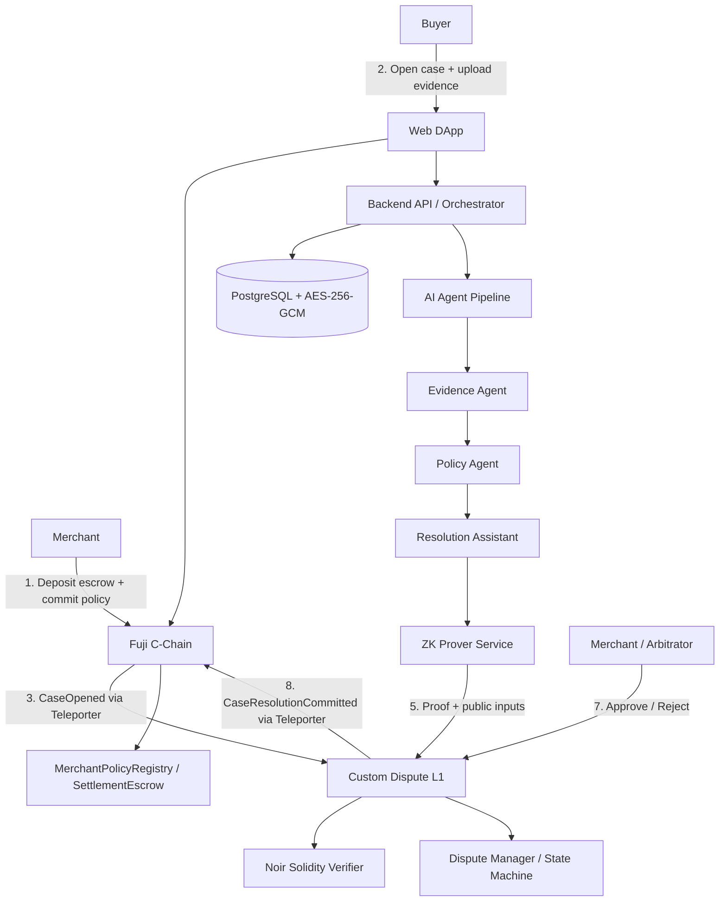
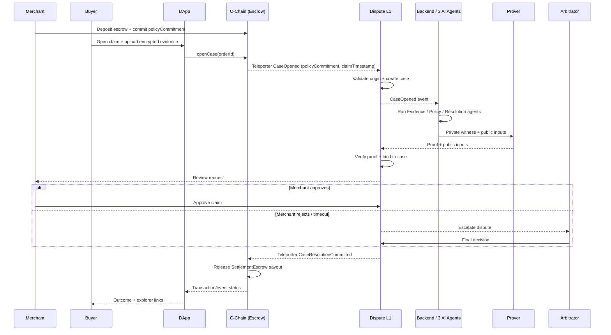

# Avalanche Private Warranty & Dispute Protocol — Quy trình kỹ thuật và kế hoạch triển khai

> **Tên dự án tạm thời:** Giao thức xử lý khiếu nại và bảo hành bảo vệ quyền riêng tư trên Avalanche  
> **Mục tiêu:** MVP sẵn sàng cho hackathon (team 3 người, 5 ngày), với kiến trúc có thể mở rộng thành AI Agent Marketplace  
> **Mạng demo chính:** Avalanche Fuji C-Chain + một Avalanche L1 tùy chỉnh trên Fuji  
> **Nguyên tắc kiến trúc:** Một câu chuyện sản phẩm xuyên suốt; mỗi thành phần nâng cao (L1, ICM, AI, ZK) phải giải quyết đúng một bài toán cụ thể.

---

## 1. Khuyến nghị tổng quan

Để tránh lỗi ghép hai sản phẩm rời rạc (sàn bán license AI agent + khiếu nại bảo hành), MVP tập trung vào **một câu chuyện thống nhất**: **Giao thức xử lý khiếu nại & bảo hành bảo vệ quyền riêng tư cho thương mại trên Avalanche** (trong đó pipeline 3 AI agent đóng vai trò chuẩn bị và đối chiếu hồ sơ tự động; phần mở rộng thành marketplace cho bên thứ ba đăng agent và bán license sẽ nằm ở giai đoạn sau hackathon).

Kiến trúc sử dụng **hai Avalanche chain**:

1. **Fuji C-Chain — Miền Thương mại công khai và Ký quỹ thanh toán (`SettlementEscrow`)**
   - Người bán (Merchant) đăng ký chính sách bảo hành, đặt cọc bảo chứng vào `SettlementEscrow`, và ghi nhận `policyCommitment` (commitment có ngẫu nhiên hóa của điều khoản hợp đồng/bảo hành) lên chain **ngay tại thời điểm mua hàng**.
   - Người mua (Buyer) mở hồ sơ khiếu nại công khai và nhận tiền bồi thường từ escrow khi khiếu nại được duyệt.
   - Trạng thái công khai để người dùng và ban giám khảo có thể kiểm tra trên EVM block explorer quen thuộc.

2. **Avalanche L1 tùy chỉnh (`Dispute L1`) — Miền quy trình xử lý tranh chấp**
   - Một EVM chain chuyên biệt quản lý state machine của tranh chấp, tham chiếu phiên bản chính sách, xác minh ZK proof, phê duyệt của Người bán / Trọng tài và nhật ký kiểm toán.
   - Tập validator và cấu hình chain được quản lý riêng, độc lập với C-Chain (tách biệt tải xử lý tranh chấp và chi phí gas khỏi mạng thương mại công khai).

3. **Teleporter / Interchain Messaging (ICM)**
   - Chuyển các thông điệp đã được xác thực giữa hai Avalanche chain.
   - C-Chain phát sự kiện/thông điệp `CaseOpened` (kèm `policyCommitment` đã lưu lúc mua và `claimTimestamp = block.timestamp`); L1 ghi nhận hồ sơ. Sau khi proof được xác minh và Người bán/Trọng tài duyệt, L1 phát `CaseResolutionCommitted`; C-Chain nhận thông điệp và mở khóa giải ngân/hoàn tiền từ `SettlementEscrow`.

4. **Quyền riêng tư + ZK (Noir + Barretenberg)**
   - Hợp đồng nhạy cảm, hóa đơn, bằng chứng, giá trị bồi thường tối đa và ngày mua được giữ ở dạng mã hóa ngoài chain.
   - Một circuit **Noir + Barretenberg** chứng minh: (a) các điều khoản bí mật khớp với `policyCommitment` đã được Người bán cam kết on-chain **từ lúc mua hàng**, (b) `claimTimestamp` (public input từ `block.timestamp`) nằm trong thời hạn bảo hành, và (c) số tiền bồi thường đề xuất không vượt quá mức tối đa — mà không tiết lộ các giá trị bí mật đó.
   - **zkML không nằm trong phạm vi MVP** (để tránh quá tải cho team 3 người trong 5 ngày; có thể phát triển sau hackathon).

### Vì sao đây là phương án cân bằng tốt?

Thiết kế này giữ nguyên toàn bộ chiều sâu kỹ thuật (smart contract escrow, EVM L1 tùy chỉnh, nhắn tin xuyên chain Teleporter, điều phối AI pipeline, mã hóa và ZK circuit), đồng thời khắc phục lỗ hổng logic của việc backend tự tạo commitment lúc khiếu nại và loại bỏ phần mua license agent thừa thãi khỏi luồng chính của người mua.

**Điều kiện để MVP được xem là thành công:** Người bán ghi nhận `policyCommitment` và nạp cọc bảo hành trên C-Chain; Người mua mở tranh chấp trên C-Chain; hồ sơ chuyển tiếp sang Dispute L1 qua Teleporter; AI pipeline xử lý bằng chứng; ZK proof hợp lệ được xác minh on-chain trên L1; Người bán (hoặc Trọng tài) phê duyệt; kết quả quay về C-Chain qua Teleporter và `SettlementEscrow` giải ngân tiền bồi thường.

---

## 2. Phạm vi sản phẩm: Giao thức khiếu nại bảo hành riêng tư

Thay vì bắt người dùng mua license AI agent trước khi khiếu nại, sản phẩm tập trung vào một luồng thương mại rõ ràng giữa hai bên thực tế:

- **Người bán (Merchant):** Đăng ký chính sách bảo hành trên nền tảng, nạp tiền ký quỹ bảo chứng vào `SettlementEscrow` trên Fuji C-Chain, và phát hành đơn hàng/hóa đơn kèm `policyCommitment` (cam kết mật mã của điều khoản riêng tư: ngày mua, ngày hết hạn bảo hành, mức bồi thường tối đa) được ghi lên chain **ngay lúc mua hàng**.
- **Người mua (Buyer):** Khi thiết bị/dịch vụ gặp lỗi, gửi khiếu nại và tải bằng chứng riêng tư lên hệ thống. Giao thức tự động kích hoạt pipeline 3 AI agent để chuẩn bị hồ sơ và dùng ZK proof chứng minh khiếu nại hợp lệ theo `policyCommitment` đã ký lúc mua.
- **Người bán / Trọng tài (Reviewer / Arbitrator):** Người bán xem xét bằng chứng được cấp quyền và khuyến nghị của AI rồi duyệt/từ chối. Nếu Người bán từ chối hoặc quá hạn phản hồi, hồ sơ chuyển cho Trọng tài (Arbitrator) quyết định cuối cùng.

*(Phần mở rộng thành AI Agent Marketplace cho phép bên thứ ba đăng và bán license agent theo từng ngành hàng sẽ nằm ở giai đoạn P2 sau hackathon.)*

### Pipeline 3 AI Agent trong MVP

Xây dựng 3 agent hoạt động thực sự chạy tuần tự như một pipeline chuẩn bị hồ sơ:

| Agent | Trách nhiệm | Đầu ra |
|---|---|---|
| Evidence Agent (Agent xử lý bằng chứng) | Trích xuất dữ kiện chính từ hóa đơn/ảnh lỗi và xác định bằng chứng còn thiếu | Bản tóm tắt bằng chứng có cấu trúc + tham chiếu đến bằng chứng |
| Policy Agent (Agent phân tích chính sách) | Đối chiếu các điều khoản bảo hành/hoàn tiền trong hợp đồng riêng tư của đơn hàng | Các điều khoản áp dụng + dữ liệu đầu vào cho ZK circuit |
| Resolution Assistant (Trợ lý đề xuất phương án giải quyết) | Kết hợp kết quả phân tích và đề xuất mức bồi thường | Khuyến nghị có thể giải thích để Người bán / Trọng tài xem xét |

### Ranh giới của sản phẩm

Nền tảng là một **quy trình hỗ trợ chuẩn bị và giải quyết tranh chấp bằng AI + ZK**, không phải tòa án tự động hay cơ quan có thẩm quyền pháp lý. AI chỉ tổ chức dữ kiện và đề xuất phương án. Người bán hoặc Trọng tài được ủy quyền phê duyệt thỏa thuận. Smart contract `SettlementEscrow` chỉ giải ngân sau khi có cả ZK proof hợp lệ và phê duyệt bắt buộc.

---

## 3. Kiến trúc hệ thống



### Trách nhiệm của từng lớp

| Lớp | Quản lý | Không được chứa |
|---|---|---|
| C-Chain | Đăng ký Merchant, `SettlementEscrow` giữ cọc bảo hành, `policyCommitment` ghi nhận lúc mua hàng, tham chiếu trạng thái hồ sơ | Nội dung hợp đồng, thông tin cá nhân, tệp bằng chứng, nội dung chat, API key |
| Custom L1 | Trạng thái tranh chấp, hash phiên bản chính sách, kết quả xác minh ZK, phê duyệt của Người bán / Trọng tài, nhật ký kiểm toán | Bằng chứng thô, điều khoản hợp đồng dạng văn bản rõ, prompt bí mật, thông tin nhận dạng cá nhân |
| Backend | Xác thực, điều phối, kiểm tra quyền truy cập, lưu trữ mã hóa AES trong PostgreSQL, gọi AI, điều phối prover | Private key không được bảo vệ hoặc quyền tự ý giải ngân tiền |
| AI runtime | Phân loại, trích xuất bằng chứng, đối chiếu điều khoản, đưa ra khuyến nghị | Quyền quyết định cuối cùng hoặc tự giải ngân tiền |
| ZK prover | Xử lý private witness và tạo proof khớp với `policyCommitment` đã lưu on-chain | Công khai tài liệu gốc hoặc tự tạo/thay đổi `policyCommitment` lúc mở tranh chấp |

### Tech stack đề xuất

- **Frontend:** Next.js + TypeScript + Tailwind; kết nối ví bằng wagmi/viem hoặc ví Avalanche tương thích (Core Wallet).
- **Contracts:** Solidity 0.8.x; Foundry hoặc Hardhat.
- **Avalanche L1:** Avalanche L1 tương thích EVM được tạo trên Fuji qua Avalanche Builder Hub / Console hoặc CLI.
- **ICM:** Teleporter contracts + Avalanche Interchain SDK; dùng relayer được host sẵn trong giai đoạn thử nghiệm đầu, lưu cấu hình để dựng lại nhanh nếu relayer tạm thời hết hạn.
- **Backend & Lưu trữ:** Node.js (NestJS/Express) + **PostgreSQL (mã hóa AES-256-GCM tại tầng ứng dụng cho tài liệu và dữ liệu nhạy cảm)** — đủ gọn nhẹ cho MVP 5 ngày, không cần dựng thêm object storage riêng.
- **AI:** API từ nhà cung cấp (Gemini/OpenAI/Groq) qua adapter phía server. Giữ API key ở phía server.
- **ZK core:** Noir + Barretenberg cho circuit kiểm tra điều kiện bảo hành và EVM verifier. *(Bỏ qua zkML trong phạm vi MVP.)*

---

## 4. Kiến trúc Avalanche: Vì sao cần custom L1?

Custom Avalanche L1 hợp lý khi sản phẩm cần một miền thực thi riêng, có chính sách validator, tham số chain, cấu hình phí, mô hình truy cập hoặc workload ứng dụng chuyên biệt. Không nên mô tả L1 như một tính năng bảo mật quyền riêng tư tự thân. Validator trên một L1 permissioned vẫn có thể kiểm tra dữ liệu được ghi lên chain đó.

### Vai trò của các chain được đề xuất

**Fuji C-Chain** là bề mặt marketplace và thanh toán công khai, dễ kiểm tra. Đây là nơi ban giám khảo có thể xem contract marketplace, giao dịch license/thanh toán và tham chiếu công khai đến hồ sơ.

**Dispute L1** là chain chuyên dụng cho workflow. Nó quản lý state machine của tranh chấp và xác minh ZK proof trước khi ghi nhận trạng thái proof đã được xác minh. Điều này tạo ra lý do cụ thể để dùng L1 riêng thay vì chỉ tạo một chain để tuyên bố dự án có custom chain.

### Những gì nên tùy chỉnh

Giữ custom L1 ban đầu ở mức đơn giản:

- Thực thi tương thích EVM để nhóm tiếp tục dùng Solidity và các công cụ quen thuộc.
- Ghi chép rõ chain ID, RPC endpoint, native gas token/cấu hình phí và genesis allocation.
- Dùng mô hình validator permissioned cho prototype, kèm vai trò operator được nêu tên và quy trình nâng cấp/quản trị được tài liệu hóa.
- Chỉ thêm custom precompile hoặc thay đổi hành vi VM khi có yêu cầu cụ thể. Không tự tạo VM riêng chỉ để demo.

Tài liệu Avalanche mô tả quy trình tạo chain/subnet và chuyển nó thành Avalanche L1. Quy trình L1 hiện nay chính xác hơn cách gọi chung chung “chỉ là một Subnet”; trong tài liệu cũ, thuật ngữ Subnet vẫn được dùng ở một số bước tạo chain. Hãy dùng **Avalanche L1** làm thuật ngữ chính của sản phẩm và chỉ nhắc đến Subnet khi giải thích cách thiết lập bên dưới.

### Tính thực tế của validator

Tài liệu hỗ trợ Avalanche gợi ý năm validator là mức tối thiểu thực tế để tăng khả năng chống chịu, đồng thời lưu ý chain về mặt kỹ thuật có thể chạy với ít validator hơn. Trong hackathon, node testnet được quản lý sẵn có thể giúp giảm thời gian thiết lập, nhưng các node đó có thể chỉ tồn tại tạm thời. Nếu nhóm chỉ chạy một hoặc hai validator, hãy gọi đó là mạng phát triển/demo; không nên quảng bá nó như một hệ thống phi tập trung hoặc có khả năng chịu lỗi ở cấp production.

### Checklist thiết lập L1

1. Quyết định prototype sẽ permissioned hay permissionless. Với trường hợp sử dụng này, nên bắt đầu bằng permissioned.
2. Chọn EVM chain ID duy nhất và xác định genesis/cấu hình phí.
3. Tạo L1 trên Fuji bằng workflow Builder Hub hiện tại.
4. Khởi chạy và đăng ký các validator node; lưu NodeID và cấu hình quản lý validator.
5. Xác nhận RPC của L1, chain ID, việc tạo block, kết nối ví và khả năng xem trên explorer.
6. Deploy contract `DisputeManager` và ZK verifier.
7. Lưu riêng blockchain ID của L1 và EVM chain ID. Teleporter routing cần Avalanche blockchain ID; cấu hình ví thường cần EVM chain ID.

**Không bắt đầu bằng L1 production trên mainnet.** Hãy xây dựng và kiểm thử trên Fuji trước.

---

## 5. Teleporter / ICM: trường hợp sử dụng xuyên chain thực tế

ICM không phải một cây cầu được thêm vào cho đẹp. Nó cần truyền một số thông điệp ứng dụng nhỏ để việc tách hệ thống thành hai chain thực sự có ích.

### Luồng thông điệp A — mở một tranh chấp

1. *(Trước đó, lúc mua hàng)*: Người bán (Merchant) đã ghi nhận `policyCommitment` (cam kết điều khoản bảo hành riêng tư) lên C-Chain kèm chữ ký xác nhận và nạp tiền cọc vào `SettlementEscrow`.
2. Khi xảy ra sự cố, Người mua mở tranh chấp từ DApp cho `orderId` tương ứng.
3. `MarketplaceGateway` trên C-Chain kiểm tra đơn hàng tồn tại, lấy `policyCommitment` đã lưu từ lúc mua và `claimTimestamp = block.timestamp`.
4. Contract gửi một Teleporter message đến custom L1, chỉ chứa:
   - `caseId` (mã định danh ngẫu nhiên, không mang ý nghĩa trực tiếp),
   - `policyCommitment` (commitment có ngẫu nhiên hóa đã cam kết lúc mua hàng),
   - `claimTimestamp` (`block.timestamp` tại thời điểm mở hồ sơ),
   - `policyVersionHash`,
   - tham chiếu chain nguồn và nonce.
5. `DisputeInbox` trên L1 xác thực chain nguồn và contract gửi đã được phê duyệt, ngăn thông điệp trùng lặp/bị phát lại, rồi tạo trạng thái hồ sơ nội bộ.
6. Backend nhận event và khởi chạy pipeline AI off-chain.

### Luồng thông điệp B — công bố kết quả đã được Người bán / Trọng tài xem xét

1. AI pipeline (Evidence → Policy → Resolution) tạo khuyến nghị có thể giải thích ở ngoài chain.
2. ZK prover tạo proof cho điều kiện chính sách, chứng minh các giá trị bí mật khớp với `policyCommitment` đã lưu on-chain từ lúc mua hàng và hợp lệ so với `claimTimestamp`.
3. L1 verifier kiểm tra proof; `DisputeManager` chỉ ghi nhận `ProofVerified` nếu xác minh thành công.
4. Người bán (Merchant) xem xét bằng chứng và phê duyệt/từ chối phương án bồi thường; nếu Người bán từ chối hoặc quá hạn phản hồi, Trọng tài (Arbitrator) xem xét và ra quyết định cuối cùng. L1 ghi nhận danh tính/vai trò reviewer cùng quyết định.
5. L1 gửi Teleporter message đến C-Chain, chứa:
   - `caseId`,
   - `outcomeCode` (mã kết quả tổng quát, không nhạy cảm),
   - `proofHash` hoặc tham chiếu proof receipt,
   - `policyVersionHash`,
   - tham chiếu phê duyệt và nonce của thông điệp.
6. `DisputeResultReceiver` trên C-Chain xác thực chain nguồn và contract gửi, ghi nhận kết quả và mở khóa `SettlementEscrow` để giải ngân tiền bồi thường cho Người mua nếu được phê duyệt.

### Trách nhiệm của các contract xuyên chain

- `MarketplaceGateway` (C-Chain): tạo tham chiếu công khai cho hồ sơ và gửi `CaseOpened`.
- `DisputeInbox` (L1): triển khai Teleporter receiver interface và xác thực thông điệp đến từ nguồn được phê duyệt.
- `DisputeManager` (L1): quản lý state transition và quy tắc phê duyệt.
- `DisputeResultReceiver` (C-Chain): chỉ chấp nhận các thông điệp kết quả hợp lệ từ sender L1 đã được cấu hình.

### Các bước thiết lập hạ tầng Teleporter

1. Xác nhận Teleporter messenger có sẵn trên Fuji C-Chain.
2. Deploy `TeleporterMessenger` và `TeleporterRegistry` trên custom L1 theo hướng dẫn deploy chính thức hiện tại.
3. Cấu hình relayer cho Fuji C-Chain ↔ custom L1. Relayer được host sẵn phù hợp cho một bài kiểm thử ngắn; nó có thể hết hạn sau một khoảng thời gian giới hạn. Tự host relayer là lựa chọn lâu dài hơn.
4. Nạp gas cho relayer và các tài khoản chain cần thiết khi áp dụng.
5. Deploy contract gửi và nhận trên cả hai chain.
6. Gửi một ping message tối giản trước khi tích hợp workflow tranh chấp đầy đủ.
7. Kiểm thử cả hai chiều và lưu transaction hash ở chain nguồn, transaction hash ở chain đích, message ID và trạng thái giao nhận cuối cùng.

**Điểm cực kỳ quan trọng:** thông điệp có thể được phát trên chain nguồn nhưng vẫn chưa được giao nếu relayer không hoạt động. Relayer vận chuyển thông điệp; chain đích xác minh thông điệp đã được xác thực. Không được xem bản thân relayer là gốc rễ của niềm tin.

### Checklist bảo mật xuyên chain

- Allowlist chính xác source blockchain ID và địa chỉ contract nguồn.
- Xác thực caller Teleporter messenger trong receiver.
- Có nonce/message ID duy nhất và từ chối xử lý thông điệp trùng lặp.
- Handler phía receiver phải có tính idempotent (xử lý lặp lại không làm thay đổi kết quả ngoài dự kiến).
- Kiểm tra hồ sơ đang ở đúng trạng thái trước khi áp dụng thông điệp.
- Quy định timeout và phương án khôi phục thủ công khi thông điệp bị chậm hoặc mắc kẹt.
- Không gửi điều khoản hợp đồng riêng tư, bằng chứng thô, danh tính người dùng hoặc thông tin xác thực API qua Teleporter.
- Không xem việc giao nhận thông điệp là bằng chứng cho thấy quyết định nghiệp vụ tự thân là đúng.

---

## 6. Mô hình quyền riêng tư: mã hóa trước, ZK sau

Zero-knowledge proof giúp chứng minh các mệnh đề về đầu vào riêng tư. Chúng không thay thế mã hóa, kiểm soát truy cập, quản lý khóa an toàn hoặc thu thập bằng chứng đáng tin cậy.

### Phân loại dữ liệu

| Dữ liệu | Nơi lưu trữ | Cách xử lý trên chain công khai |
|---|---|---|
| PDF hợp đồng / hóa đơn / ảnh | PostgreSQL (mã hóa AES-256-GCM tại tầng ứng dụng) | Không lưu nội dung tệp; tối đa chỉ lưu hash toàn vẹn ngoài luồng công khai |
| Danh tính và thông tin liên hệ người dùng | Backend database được bảo vệ | Tuyệt đối không công khai |
| Giá trị hợp đồng, ngày mua, ngày hết hạn, tiền bồi thường tối đa | Off-chain có mã hóa | Không công khai dạng văn bản rõ; chỉ công bố `policyCommitment` từ lúc mua |
| AI prompt và lịch sử hội thoại | Backend database được bảo vệ | Tuyệt đối không công khai |
| Merchant ID, cấu hình Escrow, `policyCommitment` | C-Chain | Công khai metadata đơn hàng và cam kết |
| Trạng thái hồ sơ, `claimTimestamp`, mã kết quả không nhạy cảm | Custom L1 và/hoặc C-Chain | Chỉ công bố thông tin cần thiết |
| ZK proof và public input | L1 verifier / nơi lưu proof | Chỉ công bố proof nếu public input không làm lộ dữ liệu nhạy cảm |

### Thiết kế commitment

Một hash thuần của giá trị dễ đoán có thể làm lộ thông tin thông qua việc thử đoán. Với các trường hợp đồng riêng tư, hãy dùng **commitment có ngẫu nhiên hóa** (ví dụ commitment dựa trên Poseidon cùng một nonce bí mật) và giữ nonce ở trạng thái riêng tư. Cách tạo commitment phải nhất quán giữa lúc phát hành đơn hàng, circuit và verifier.

**Nguyên tắc bắt buộc để ZK có giá trị chứng minh:** `policyCommitment` **phải được tạo và ghi lên C-Chain ngay tại thời điểm mua hàng** (với chữ ký xác nhận của Người bán), không phải do backend tự tạo lúc mở tranh chấp. Nếu backend tự tạo commitment lúc mở tranh chấp, bên tạo proof có thể tự chọn số liệu khớp với điều kiện hợp lệ và proof sẽ mất ý nghĩa.

### Vòng đời dữ liệu thực tế

1. **Lúc mua hàng:** Người bán tạo `policyCommitment` từ các điều khoản riêng tư + nonce bí mật, ký xác nhận và ghi lên C-Chain cùng tiền ký quỹ vào `SettlementEscrow`. Dữ liệu rõ được mã hóa AES-256-GCM lưu ở PostgreSQL (hoặc bàn giao bản mã hóa cho Người mua/Người bán).
2. **Lúc mở khiếu nại:** Người mua tải hóa đơn/bằng chứng lỗi lên qua HTTPS; backend kiểm tra file và mã hóa AES-256-GCM trước khi lưu.
3. C-Chain ghi nhận `claimTimestamp = block.timestamp` và chuyển `policyCommitment` + `claimTimestamp` sang Dispute L1 qua Teleporter.
4. AI agent chỉ xử lý dữ liệu cần thiết cho vai trò của mình. Tránh gửi dữ liệu cá nhân không cần thiết đến nhà cung cấp model bên ngoài.
5. Prover nhận private witness từ backend/prover service được kiểm soát.
6. Chỉ proof, `policyCommitment`, `claimTimestamp`, `policyVersionHash` và kết quả công khai mới được gửi đến L1 verifier.
7. Người bán (và Trọng tài nếu có kháng nghị) xem bằng chứng riêng tư mà họ được cấp quyền truy cập trong giao diện review và phê duyệt/từ chối khuyến nghị.
8. L1 công bố trạng thái tối thiểu; C-Chain nhận tham chiếu kết quả và giải ngân `SettlementEscrow` theo phê duyệt.

---

## 7. Thiết kế ZK proof: tính năng bảo vệ quyền riêng tư bắt buộc

### Circuit đầu tiên được khuyến nghị: kiểm tra điều kiện bảo hành/hoàn tiền riêng tư

Đừng bắt đầu bằng việc chứng minh toàn bộ câu trả lời AI. Hãy bắt đầu bằng một quy tắc nhỏ, có tính xác định, dễ hiểu và dễ kiểm thử.

**Ví dụ private input (witness):**

- Ngày mua hàng,
- Ngày kết thúc bảo hành,
- Mức bồi thường tối đa theo hợp đồng (riêng tư),
- Số tiền bồi thường được đề xuất,
- Nonce ngẫu nhiên của `policyCommitment`,
- Các trường chính sách riêng tư khác cần được ràng buộc vào commitment.

**Ví dụ public input:**

- `caseId` hoặc hash của nó,
- `policyVersionHash`,
- `policyCommitment` (đã được ghi on-chain lúc mua hàng, không tự sinh lúc khiếu nại),
- `claimTimestamp` (lấy từ `block.timestamp` on-chain lúc mở hồ sơ, tuyệt đối không để là private input),
- `eligible = true/false` hoặc một mã kết quả tổng quát,
- Nullifier dùng một lần để ngăn việc tái sử dụng proof.

**Circuit chứng minh:**

1. Các trường chính sách riêng tư tương ứng với `policyCommitment` đã được Người bán cam kết on-chain từ lúc mua hàng.
2. `claimTimestamp` (public) nằm trong khoảng `[purchaseTimestamp, warrantyEndTimestamp]`.
3. Số tiền đề xuất nằm trong mức bồi thường tối đa theo hợp đồng riêng tư.
4. Proof được ràng buộc với hồ sơ (`caseId`) và phiên bản chính sách cụ thể, không thể tái sử dụng cho một hồ sơ khác.

**Proof không chứng minh được:**

- Không chứng minh hóa đơn hoặc hợp đồng đã tải lên là hàng thật/tài liệu xác thực.
- Không chứng minh khuyến nghị AI công bằng hoặc đúng pháp luật.
- Không chứng minh reviewer là con người đã kiểm tra bằng chứng gốc.
- Không che giấu thông tin vô tình bị đưa vào public input.

Để xác thực tài liệu, hãy dùng chữ ký của bên phát hành, timestamp đáng tin cậy, xác minh nguồn và kiểm tra của reviewer khi cần. ZK proof chỉ chứng minh phép tính được mã hóa trong circuit đã thỏa mãn với witness được cung cấp.

### Lộ trình triển khai đề xuất: Noir + Barretenberg

1. Viết một Noir circuit nhỏ cho điều kiện bảo hành/mức bồi thường.
2. Compile circuit và tạo test witness.
3. Tạo proof cục bộ và xác minh cục bộ trước.
4. Tạo EVM/Solidity verifier bằng phiên bản và cấu hình Barretenberg tương ứng.
5. Deploy verifier lên custom L1.
6. Thêm contract `ProofGate` gọi verifier với public input và chỉ đánh dấu hồ sơ đã được xác minh proof một lần.
7. Ràng buộc public input với `caseId`, `policyVersionHash`, chain/domain và nullifier dùng một lần.
8. Thêm test case cho proof hợp lệ và không hợp lệ.
9. Đo thời gian tạo proof, gas xác minh và kích thước contract khi deploy.

**Cổng kiểm tra tương thích & kích thước contract:** EVM verifier do Barretenberg sinh ra yêu cầu các precompile liên quan đến elliptic curve và modular exponentiation, đồng thời **thường có kích thước lớn (dễ chạm giới hạn 24KB của EVM)**. Cần deploy thử một verifier hello-world lên **chính custom L1** ngay trong Ngày 1; không để bài kiểm tra precompile và bytecode size đến ngày cuối.

### Tính năng ZK cần trình diễn trong demo

Dùng một contract demo với các điều khoản giả lập. Trình bày một hồ sơ có giá trị riêng tư thỏa mãn chính sách, tạo proof hợp lệ và để L1 chấp nhận proof. Sau đó thay đổi một giá trị riêng tư khiến chính sách bị vi phạm và cho thấy quá trình tạo/xác minh proof thất bại. Ban giám khảo cần thấy hệ thống xác minh một mệnh đề mà không tiết lộ các giá trị riêng tư.

---

## 8. zkML: bỏ khỏi MVP (chỉ là hướng mở rộng sau hackathon)

Với team 3 người trong 5 ngày, **bỏ hẳn zkML khỏi phạm vi MVP**. Tập trung 100% vào Noir policy circuit để chứng minh điều kiện bảo hành/hoàn tiền khớp với `policyCommitment` đã lưu on-chain. Sau hackathon, nếu cần mở rộng, có thể dùng EZKL cho một bộ phân loại ONNX nhỏ ở giai đoạn P2.

---

## 9. Kế hoạch các module smart contract

### Contract trên C-Chain

**`MerchantPolicyRegistry`** *(thay cho `AgentRegistry` + bỏ `AgentLicense` NFT ở P0)*
- Đăng ký Merchant, phiên bản chính sách bảo hành (`policyVersionHash`) và ghi nhận `policyCommitment` cho từng đơn hàng lúc mua hàng (có chữ ký/xác nhận của Merchant).
- Phát các event `MerchantRegistered`, `OrderCommitted(orderId, policyCommitment, purchaseTimestamp)`.

**`SettlementEscrow`** *(Bắt buộc P0 — không còn là tùy chọn)*
- Giữ tiền cọc bảo hành của Người bán (hoặc tiền ký quỹ đơn hàng) theo các điều kiện rõ ràng.
- Chỉ giải ngân bồi thường cho Người mua khi nhận được kết quả hợp lệ từ `DisputeResultReceiver` (đã qua xác minh ZK + phê duyệt của Người bán hoặc Trọng tài).
- Có đường xử lý timeout khi Người bán không phản hồi.

**`MarketplaceGateway`**
- Nhận yêu cầu mở tranh chấp từ Người mua, lấy `policyCommitment` đã lưu từ `MerchantPolicyRegistry` và `claimTimestamp = block.timestamp`.
- Gửi `CaseOpened` qua Teleporter đến Dispute L1.

**`DisputeResultReceiver`**
- Nhận result message từ Dispute L1 đã được cấu hình.
- Xác thực chain nguồn/sender, cập nhật trạng thái đơn hàng và kích hoạt giải ngân trên `SettlementEscrow`.

*(Ghi chú: `AgentRegistry` và `AgentLicense` NFT cho phép bên thứ ba bán agent được chuyển xuống P2 để không làm loãng phạm vi MVP.)*

### Contract trên custom L1

**`DisputeInbox`**
- Nhận `CaseOpened` message thông qua Teleporter.
- Xác thực nguồn và loại bỏ thông điệp trùng lặp.

**`DisputeManager`**
- Duy trì state machine nhỏ:

```text
NONE -> OPENED -> ANALYZING -> PROOF_VERIFIED -> MERCHANT_REVIEW
                                      |                 |
                                      |                 +-> APPROVED -> SETTLED
                                      |                 +-> REJECTED -> ARBITRATOR_REVIEW -> SETTLED / DENIED
                                      +-> PROOF_FAILED
```

- Ghi nhận `policyVersionHash`, `policyCommitment`, `claimTimestamp`, phê duyệt của Người bán / Trọng tài và timestamp.
- Thực thi chuyển trạng thái dựa trên role; không cho phép nhảy trạng thái tùy ý.

**`ProofGate`**
- Gọi ZK verifier được sinh ra.
- Ràng buộc việc xác minh proof với đúng `caseId`, `policyCommitment` từ lúc mua, `claimTimestamp`, `policyVersionHash` và nullifier dùng một lần.
- Từ chối proof trùng lặp hoặc bị phát lại.

**`DisputeResultSender`**
- Gửi kết quả không nhạy cảm đã được phê duyệt về C-Chain qua Teleporter.

### Checklist kiểm thử contract

- Người bán chưa nạp cọc vào `SettlementEscrow` không thể phát hành đơn hàng có bảo hành.
- `policyCommitment` chỉ có thể được ghi lúc tạo đơn hàng, không thể sửa đổi khi đã mở tranh chấp.
- Chỉ Teleporter messenger đã cấu hình mới có thể gọi các entry point của receiver.
- Thông điệp từ chain nguồn/sender chưa được phê duyệt bị từ chối.
- Thông điệp trùng lặp bị bỏ qua hoặc revert một cách an toàn.
- Proof thuộc hồ sơ khác, sai `policyCommitment` hoặc sai `claimTimestamp` bị từ chối.
- Không thể tái sử dụng proof.
- Vai trò Người bán / Trọng tài không thể bị backend AI âm thầm thay thế.
- Không thể giải ngân `SettlementEscrow` trước khi đáp ứng đủ ZK proof + phê duyệt.

---

## 10. Workflow đầu-cuối

### Hành trình người dùng

1. **Lúc mua hàng:** Người bán đăng ký chính sách, nạp tiền cọc bảo hành vào `SettlementEscrow` và ghi `policyCommitment` (cam kết điều khoản riêng tư + nonce bí mật) lên Fuji C-Chain.
2. **Mở khiếu nại:** Khi thiết bị gặp lỗi, Người mua mở tranh chấp cho đơn hàng trên DApp và tải bằng chứng (hóa đơn/ảnh lỗi) lên backend (mã hóa AES-256-GCM trong PostgreSQL).
3. C-Chain lấy `policyCommitment` đã lưu từ bước 1, gắn `claimTimestamp = block.timestamp` và gửi `CaseOpened` qua Teleporter sang Dispute L1.
4. Dispute L1 tạo trạng thái tranh chấp (`OPENED`).
5. Backend chạy pipeline 3 AI agent: Evidence → Policy → Resolution để trích xuất dữ kiện và đề xuất mức bồi thường.
6. ZK prover tạo proof chứng minh điều kiện bảo hành và mức bồi thường đề xuất hợp lệ so với `policyCommitment` và `claimTimestamp`.
7. Dispute L1 xác minh proof on-chain qua `ProofGate` và chuyển trạng thái `PROOF_VERIFIED` → `MERCHANT_REVIEW`.
8. Người bán kiểm tra bằng chứng được cấp quyền và khuyến nghị của AI:
   - Nếu Người bán **Approve** → ghi nhận phê duyệt.
   - Nếu Người bán **Reject** hoặc quá hạn → chuyển Trọng tài (Arbitrator) xem xét và quyết định cuối cùng.
9. L1 gửi result message tối thiểu (`CaseResolutionCommitted`) về C-Chain qua Teleporter.
10. C-Chain xác thực thông điệp, cập nhật trạng thái và `SettlementEscrow` giải ngân tiền bồi thường cho Người mua.
11. Người mua và Người bán kiểm tra link giao dịch trên cả hai explorer.

### Sequence diagram



---

## 11. Workflow xây dựng: kế hoạch 5 ngày cho team 3 người

Đây là lịch thực tế cho nhóm **3 người** trong **5 ngày** (đã cắt bỏ các phần thừa như `AgentLicense` NFT, object storage riêng và zkML). **Không được trì hoãn việc kiểm tra tính khả thi của L1, Teleporter hai chiều và kích thước verifier sang ngày sau.**

### Ngày 1 — Chốt kiến trúc & Thử nghiệm kỹ thuật ưu tiên rủi ro (Go / No-Go)

**Công việc**
- Chốt 1 câu chuyện duy nhất (Merchant cam kết `policyCommitment` + nạp `SettlementEscrow` lúc mua → Buyer mở khiếu nại → AI pipeline → ZK proof → Merchant/Arbitrator duyệt → Giải ngân Escrow).
- Tạo custom L1 trên Fuji (lưu cấu hình để dựng lại nhanh nếu node/relayer Builder Hub hết hạn).
- Deploy Teleporter và gửi ping **hai chiều** (Fuji C-Chain ↔ Dispute L1).
- Compile một Noir circuit hello-world, sinh Solidity verifier và **deploy thử lên chính Dispute L1** để kiểm tra precompile và **kích thước contract (< 24KB)**.

**Điều kiện Go / No-Go cuối Ngày 1:** Phải có L1 chạy được + ping hai chiều thành công + verifier deploy được lên L1. Nếu L1/ICM bị chặn, chuyển sang local/dev L1; nếu verifier vượt quá 24KB hoặc thiếu precompile, chốt phương án dự phòng ngay từ cuối Ngày 1 (và ghi rõ trong tài liệu).

### Ngày 2 — Smart Contracts, Noir Circuit thật & AI Pipeline

- **Blockchain:** Triển khai `MerchantPolicyRegistry`, `SettlementEscrow`, `MarketplaceGateway`, `DisputeInbox`, `DisputeManager`, `ProofGate`, `DisputeResultSender/Receiver` kèm unit test.
- **ZK & Backend:** Hoàn thiện Noir circuit kiểm tra `policyCommitment` + `claimTimestamp` + hạn mức bồi thường; dựng API PostgreSQL + mã hóa AES-256-GCM.
- **AI:** Triển khai pipeline 3 agent (Evidence → Policy → Resolution) trả về JSON có cấu trúc rõ ràng.

### Ngày 3 — Tích hợp đầu-cuối (End-to-End)

- Kết nối ví với Fuji C-Chain và Dispute L1.
- Nối hoàn chỉnh luồng: Merchant tạo đơn + nạp cọc → Buyer mở hồ sơ → Teleporter sang L1 → AI chạy → ZK proof verified → Merchant/Arbitrator duyệt → Teleporter về C-Chain → `SettlementEscrow` giải ngân.
- **Sản phẩm bàn giao cuối Ngày 3:** Chạy trọn vẹn 1 vụ từ lúc mở hồ sơ đến khi giải ngân trên UI mà không cần can thiệp console.

### Ngày 4 — Hoàn thiện UI & Kiểm thử các trường hợp lỗi

- Hoàn thiện UI: timeline hồ sơ trực quan, trạng thái `Proof verified on Dispute L1`, link explorer của cả 2 chain.
- Kiểm thử lỗi: proof sai `policyCommitment` / sai `claimTimestamp` / tái sử dụng nullifier, Teleporter message bị phát lại, relayer chậm/dừng (hiển thị trạng thái chờ thay vì báo thành công giả).
- Rà soát không để lộ dữ liệu nhạy cảm hay API key trong on-chain event hoặc console log.

### Ngày 5 — Đóng băng tính năng, Quay video Demo & Làm Slide

- Đóng băng tính năng; không thêm kiến trúc mới.
- Quay video demo 3–5 phút trên dữ liệu giả lập sạch (kèm bản ghi dự phòng nếu testnet chập chờn).
- Hoàn thiện slide (Kiến trúc 2 chain, Luồng commitment & ZK, Avalanche ICM, Impact & Giới hạn thực tế) và phụ lục kỹ thuật (chain ID, blockchain ID, địa chỉ contract/verifier, tx hash mẫu).

---

## 12. Phân công trách nhiệm cho team 3 người

| Vai trò | Phần việc chính | Cần phối hợp với |
|---|---|---|
| **Người 1: Blockchain / Avalanche** | Custom L1, Teleporter/relayer, toàn bộ Solidity contracts (`SettlementEscrow`, `MerchantPolicyRegistry`, `DisputeManager`, `ProofGate`...), deploy & unit test | Người 2 + Người 3 |
| **Người 2: ZK & Backend** | Noir circuit, Solidity verifier (check < 24KB), Backend API, PostgreSQL + mã hóa AES-256-GCM, điều phối prover | Người 1 + Người 3 |
| **Người 3: AI, Frontend & Tích hợp** | Pipeline 3 AI agents, Next.js DApp (timeline, reviewer console, explorer links), giữ đồng bộ ABI/event/schema, video demo & slide | Người 1 + Người 2 |

---

## 13. Cấu trúc repository

```text
project/
├── apps/
│   ├── web/                 # Next.js DApp
│   └── api/                 # Backend API + AES-256-GCM storage (PostgreSQL)
├── services/
│   ├── agents/              # Evidence, Policy, Resolution agents
│   └── prover/              # Noir witness/proof orchestration
├── contracts/
│   ├── c-chain/             # MerchantPolicyRegistry, SettlementEscrow, Gateway, ResultReceiver
│   ├── dispute-l1/          # DisputeInbox, DisputeManager, ProofGate, ResultSender
│   └── test/
├── circuits/
│   └── policy-eligibility/  # Noir source + test vectors
├── infra/
│   ├── avalanche-l1/        # Genesis/config/deployment notes
│   └── icm/                 # Teleporter + relayer configuration
├── docs/
│   ├── architecture.md
│   ├── message-schema.md
│   └── demo-script.md
└── README.md
```

Không commit `.env`, private key, API key, tài liệu người dùng thật chưa mã hóa hoặc prover secret. Hãy tạo `.env.example` chỉ chứa tên biến mẫu, không chứa giá trị bí mật.

---

## 14. Kịch bản demo (3–5 phút)

**Tình huống:** Một khách hàng mua thiết bị có bảo hành; Người bán đã nạp cọc vào `SettlementEscrow` và cam kết `policyCommitment` lên C-Chain lúc mua. Khi thiết bị hỏng, Người mua gửi khiếu nại. Ngày mua, ngày hết hạn bảo hành và mức bồi thường tối đa đều là dữ liệu riêng tư.

1. **Thiết lập đơn hàng & Escrow (30 giây):** Trên Fuji C-Chain, hiển thị đơn hàng đã được Người bán nạp cọc `SettlementEscrow` và ghi nhận `policyCommitment` từ lúc mua.
2. **Mở hồ sơ (30–40 giây):** Người mua gửi bằng chứng giả lập qua form riêng tư; giải thích file được mã hóa AES-256-GCM trong PostgreSQL và C-Chain ghi nhận `claimTimestamp = block.timestamp`.
3. **Trình diễn ICM (30–45 giây):** Mở giao dịch C-Chain hiển thị `CaseOpened`; chuyển sang explorer của Dispute L1 cho thấy hồ sơ đã được nhận.
4. **Trình diễn AI pipeline (40–50 giây):** Hiển thị đầu ra có cấu trúc của Evidence Agent → Policy Agent → Resolution Assistant (nêu rõ AI chỉ hỗ trợ chuẩn bị hồ sơ, không tự quyết định).
5. **Trình diễn ZK (40–60 giây):** Tạo proof; hiển thị public input (`caseId`, `policyCommitment` từ lúc mua, `claimTimestamp`, `eligible`) và các trường witness giữ bí mật. Gửi proof lên L1 → `ProofVerified`. Demo thêm 1 case sai điều kiện để thấy hệ thống từ chối.
6. **Phê duyệt & Giải ngân (45–60 giây):** Người bán (hoặc Trọng tài khi kháng nghị) bấm duyệt trên Dispute L1 → Teleporter gửi `CaseResolutionCommitted` về C-Chain → `SettlementEscrow` giải ngân bồi thường cho Người mua. Hiển thị đủ tx hash cả hai chain.

Không để lộ tệp contract thật, tên, địa chỉ, dữ liệu cá nhân hoặc API credential trong demo trực tiếp. Chỉ dùng dữ liệu tổng hợp/giả lập.

---

## 15. Đối chiếu với thang điểm ban giám khảo

| Tiêu chí | Những gì ban giám khảo cần kiểm chứng được | Những gì làm giảm điểm |
|---|---|---|
| Technical Implementation (25) | Luồng Escrow/Commitment lúc mua → Khiếu nại → AI pipeline → ZK proof → Duyệt → Giải ngân hoạt động thật; có test proof sai | Chỉ có UI mock, backend tự tạo commitment lúc khiếu nại, không test proof sai |
| Avalanche Integration (25) | Custom L1 đã deploy, Teleporter message hai chiều thực sự, trạng thái relayer, contract/event trên cả hai chain | Chỉ thêm ví Avalanche; không có giao nhận xuyên chain thực tế; L1 không có vai trò riêng |
| Creativity & Innovation (15) | Kết hợp AI chuẩn bị hồ sơ + ZK kiểm tra điều kiện hợp đồng bảo mật + Escrow xuyên chain trên Avalanche | AI tự ý giải ngân tiền hoặc nhét ZKML nặng nề không chạy thật |
| Impact & Use Case (15) | Kịch bản bảo hành/khiếu nại thương mại rõ ràng, bảo vệ quyền riêng tư hợp đồng, có dòng tiền Escrow thực tế | Bắt người mua phải mua license AI trước khi khiếu nại; không có dòng tiền bồi thường |
| Presentation & Pitch (10) | Câu chuyện một mạch rõ ràng, lý do kiến trúc thuyết phục, nêu thẳng giới hạn | Ghép hai sản phẩm rời rạc, nêu thuật ngữ mà không giải thích |
| UI/UX & Demo (10) | Timeline hồ sơ dễ hiểu, giao diện Người bán / Trọng tài rõ ràng, hiển thị link explorer 2 chain | Quá nhiều màn hình kỹ thuật, chuyển chain gây khó hiểu |

### Câu pitch đề xuất

> “Chúng tôi xây dựng giao thức xử lý khiếu nại và bảo hành bảo vệ quyền riêng tư trên Avalanche: Fuji C-Chain giữ tiền ký quỹ `SettlementEscrow` và `policyCommitment` từ lúc mua hàng; một Avalanche L1 chuyên dụng điều phối tranh chấp; Teleporter kết nối hai chain; AI pipeline chuẩn bị hồ sơ; còn zero-knowledge proof chứng minh khiếu nại hợp lệ theo điều khoản đã cam kết mà không làm lộ dữ liệu nhạy cảm.”

---

## 16. Rủi ro và những gì chủ động không làm

### Rủi ro kỹ thuật

- **Vận hành L1 & Relayer:** node/relayer Builder Hub có thể hết hạn. Lưu lại cấu hình để dựng lại nhanh và thêm trạng thái chờ/khôi phục thủ công khi relayer chậm.
- **Kích thước & Tương thích Verifier:** EVM verifier của Barretenberg dễ chạm giới hạn 24KB và cần precompile đặc thù. Bắt buộc test deploy lên Dispute L1 ngay Ngày 1.
- **Rò rỉ quyền riêng tư & Gian lận input:** `policyCommitment` phải được ghi từ lúc mua hàng, `claimTimestamp` phải lấy từ `block.timestamp` on-chain. Không để lộ dữ liệu nhạy cảm trong event hoặc log.
- **Độ tin cậy AI:** Giữ đầu ra có cấu trúc, bắt buộc con người (Merchant/Arbitrator) phê duyệt cuối cùng.

### Những gì không đặt làm mục tiêu cho MVP

- Marketplace đa agent & `AgentLicense` NFT (chuyển sang P2).
- zkML cho model phân loại hay LLM (bỏ khỏi MVP).
- Object storage phức tạp (chỉ dùng PostgreSQL + AES-256-GCM).
- Nền kinh tế validator permissionless chuẩn production hay ra mắt mainnet.

---

## 17. Checklist triển khai theo mức độ ưu tiên

### P0 — Bắt buộc phải hoạt động (MVP 5 ngày)

- [ ] Kết nối ví trên Fuji C-Chain và Dispute L1.
- [ ] Tạo custom Avalanche L1 trên Fuji; ghi lại RPC, EVM chain ID và blockchain ID.
- [ ] Teleporter message hai chiều thực tế: C-Chain → L1 và L1 → C-Chain.
- [ ] `MerchantPolicyRegistry` + `SettlementEscrow` (nạp cọc + ghi `policyCommitment` lúc mua, giải ngân khi thắng).
- [ ] Pipeline 3 AI agent với đầu ra JSON có cấu trúc riêng biệt.
- [ ] Lưu trữ bằng chứng off-chain mã hóa AES-256-GCM trong PostgreSQL.
- [ ] Một Noir policy circuit ràng buộc với `policyCommitment` (từ lúc mua) và `claimTimestamp` (public `block.timestamp`).
- [ ] Deploy và kiểm thử Solidity verifier (< 24KB) ngay trên Dispute L1 thực tế.
- [ ] Luồng duyệt của Merchant (và Arbitrator khi từ chối/timeout) kích hoạt giải ngân Escrow qua Teleporter.
- [ ] Demo đầu-cuối từ lúc mua hàng/nạp cọc đến khi giải ngân bồi thường.

### P1 — Các phần bổ sung nếu còn thời gian

- [ ] Chống phát lại và allowlist cross-chain message chi tiết.
- [ ] Test proof không hợp lệ / sai `policyCommitment` / sai `claimTimestamp` / nullifier bị dùng lại.
- [ ] Khôi phục thủ công khi Teleporter message bị kẹt lúc relay.
- [ ] Link explorer on-chain của cả 2 chain ngay trong UI.

### P2 — Sau hackathon

- [ ] Mở rộng thành AI Agent Marketplace (`AgentRegistry`, `AgentLicense` NFT cho bên thứ ba).
- [ ] Thử nghiệm zkML inference nhỏ với EZKL.
- [ ] Relayer tự host với monitoring và nhiều validator phi tập trung hơn.
- [ ] Audit smart contract, ZK circuit và threat modeling chính thức.

---

## 18. Tài liệu chính thức và tham khảo kỹ thuật

Dùng các tài liệu này làm điểm bắt đầu; hãy kiểm tra phiên bản hiện tại trước khi sao chép command hoặc deploy contract vì công cụ Avalanche và ZK toolchain có thể thay đổi.

### Avalanche L1 và ICM

- [Avalanche L1 — Create Your L1 (Builder Hub)](https://build.avax.network/academy/avalanche-l1/permissionless-l1s/04-speedrun-base-l1/01-create-l1-speedrun)
- [Customize an Avalanche L1](https://build.avax.network/docs/avalanche-l1s/evm-configuration/customize-avalanche-l1)
- [Avalanche L1 FAQ — validator considerations](https://support.avax.network/en/articles/6158840-l1-faq)
- [ICM infrastructure overview](https://build.avax.network/academy/avalanche-l1/interchain-messaging/04-icm-setup/01-overview)
- [Deploy Teleporter Messenger](https://docs.avax.network/academy/avalanche-l1/interchain-messaging/04-icm-setup/02-deploy-teleporter-messenger)
- [Relayer setup](https://build.avax.network/academy/avalanche-l1/interchain-messaging/04-icm-setup/04-relayer-setup)
- [Send a Teleporter message](https://build.avax.network/academy/avalanche-l1/interchain-messaging/03-icm-protocol/03-sending-a-message)
- [Receive a Teleporter message](https://build.avax.network/academy/avalanche-l1/interchain-messaging/03-icm-protocol/04-receiving-a-message)
- [Avalanche Interchain SDK](https://build.avax.network/docs/tooling/avalanche-sdk/interchain)

### ZK

- [Noir documentation](https://noir-lang.org/docs/)
- [Noir — getting started manually](https://noir-lang.org/docs/getting_started_manually)
- [Barretenberg — generate a Solidity verifier](https://barretenberg.aztec.network/docs/how_to_guides/how-to-solidity-verifier/)
- [RISC Zero zkVM quick start](https://dev.risczero.com/zkvm/quickstart)
- [RISC Zero zkVM overview](https://dev.risczero.com/api/zkvm)
- [EZKL security notes](https://github.com/zkonduit/ezkl-docs)

---

## Khuyến nghị cuối cùng

Hãy xây dựng hệ thống theo thứ tự sau:

**Custom L1 → một vòng Teleporter hai chiều → deploy thử Noir verifier (< 24KB) lên chính L1 → contract Escrow & `policyCommitment` → AI pipeline → Noir ZK policy proof → luồng Merchant/Arbitrator duyệt & giải ngân → hoàn thiện UI.**

Thứ tự này được chọn có chủ đích để kiểm tra các tích hợp rủi ro nhất từ sớm. Một demo nhỏ hơn nhưng thực sự chạy được L1 + ICM + ZK sẽ thuyết phục hơn một kiến trúc rộng, trong đó chain, relayer, verifier và AI pipeline đều mới chỉ được triển khai một phần.
